# GroupDeal — Production Blueprint
**Buy Together, Save More** · Locality-based group buying with dynamic pricing & supplier bidding
Author: Arul Murugan M

This single document compiles the engineering package in `/docs`. If anything here conflicts with `DECISIONS.md`, `DECISIONS.md` wins. Status words used throughout: **IMPLEMENTED**, **PARTIAL**, **DESIGNED/PROPOSED**, **FUTURE**, **NOT VERIFIED**.

**Executed artifacts in this package:** `packages/pricing` (TypeScript engine, 6/6 tests passing against `golden-vectors.json`). **Written but not executed:** `firestore/firestore.rules`, `firestore/firestore.indexes.json` (require the Firebase emulator).

## Contents
- **A.** Repository / Project Audit
- **B.** Final Architecture
- **C.** Complete Feature Map (Product Requirements)
- **D.** Firestore / Data Model
- **E.** Pricing Engine Specification
- **F.** Reverse Auction Specification
- **G.** Payment Architecture
- **H.** Security Architecture
- **I.** UI / UX Blueprint
- **J.** API / Service Contracts
- **K.** State Machines
- **L.** Test Strategy
- **M.** Deployment Architecture
- **N.** New Feature Plan
- **O.** Academic Report-Ready Technical Structure
- **P.** Exact Implementation Roadmap
- **Q.** Production Readiness Checklist
- **R.** Top Architectural Risks and Mitigations
- **S.** Laptop Execution Starting Point
- **Appendix 1.** Decisions and Architectural Decision Records


---

# A. Repository / Project Audit


**Scope of evidence.** Inspected directly: the `groupdeal.zip` Android project (all 22 Kotlin source files, Gradle scripts, version catalog, manifest, tests), the zeroth-review PPT, the latest poster and the generated PBL report. Anything not provable from source is marked **NOT VERIFIED**. The poster's full-stack technology list describes the *target* system; it is **not** evidence of implementation.

Status legend: **IMPLEMENTED** (works in source) · **PARTIAL** (simplified/simulated) · **PROPOSED** (designed, not coded) · **FUTURE** (beyond V1) · **NOT VERIFIED** (no evidence either way).

### A.1 What exists

| Item | Evidence | Status |
|---|---|---|
| Native Android app, single `app` module, package `com.example` | `settings.gradle.kts`, `app/build.gradle.kts` | IMPLEMENTED |
| Kotlin 2.2.10, Compose BOM 2024.09.00, Material 3, AGP 9.1.1, minSdk 24 / target 36 | version catalog | IMPLEMENTED |
| 22 Kotlin files, 5,434 lines (core 901, ui 4,494, MainActivity 39) | line counts | IMPLEMENTED |
| 9 screens/sheets: Login, Onboarding, LocalityPicker, Discover, GroupDetail, Demands, MyGroups, Orders, Profile | `ui/**` | IMPLEMENTED |
| `PricingEngine` (tier price, tier index, `validateTiers`, members-to-next-tier) | `core/engine/PricingEngine.kt` | IMPLEMENTED (`validateTiers` never called) |
| `GroupDealRepository` Kotlin `object`, 5 `StateFlow`s + `SharedFlow` events | `core/data` | IMPLEMENTED (in-memory only) |
| `LocalityService`: 15 localities / 8 cities, pincode lookup with 2-digit-prefix fallback | `core/data` | IMPLEMENTED |
| Seed data: 4 deals, 3 requests, 1 order, demo user (trust 780) | repository seeding | IMPLEMENTED |
| Unit tests: pricing, pincode, trust tier, string resource (JUnit4 + Robolectric) | `src/test` | PRESENT — Gradle run **NOT VERIFIED** (logic re-computed by a Python port: all assertions agree) |
| Roborazzi screenshot test, instrumented test | templates | PRESENT, not meaningful |

### A.2 Feature classification

| Feature | Status | Notes |
|---|---|---|
| Locality selection (search + pincode) | IMPLEMENTED | Any 6-digit number accepted, incl. invalid pincodes |
| Deal feed filtered by locality | **PARTIAL** | Feed filtered only by search + category; all seeds are Koramangala |
| Search + category filter | IMPLEMENTED | |
| Join / leave group with tier recompute | IMPLEMENTED | Client-side, single device |
| Group state machine | PARTIAL | Only OPEN/FILLING/TARGET_REACHED computed; `leaveGroup` doesn't recompute state (**defect D1**) |
| Members to next tier | PARTIAL | Derived property can go negative above target (**defect D2**) |
| Demand requests + one-vote-per-user | IMPLEMENTED | Threshold fixed at 15; no conversion to deal |
| Checkout / orders / tracking | PARTIAL | Local order record; checkout allowed before target; qty fixed at 1; tracking steps static |
| Payments (Razorpay) | PROPOSED | No SDK, no server |
| Authentication | PARTIAL (simulated) | 400 ms delay; button labelled "Sign In with Firebase" but no Firebase call |
| Roles (customer/supplier/admin) | PARTIAL (label only) | `switchDemoRole` changes a label; no authorisation |
| Supplier bidding | PARTIAL (data model only) | `SupplierBid`, BIDDING/SUPPLIER_SELECTED states, 2 seeded winning bids |
| Trust score | PARTIAL | Static score → tier mapping |
| Notifications | PARTIAL | In-app `SharedFlow` banner; no FCM |
| Price comparison vs marketplaces | PROPOSED | Only stored MRP |
| Firebase Auth/Firestore/Functions/Storage/FCM/App Check | PROPOSED | Firestore/Auth commented out; `firebase-appcheck`, `firebase-ai` declared, unused |
| MVVM / Hilt / Navigation Compose / Room / Retrofit / OkHttp / Moshi | PROPOSED | Some declared in Gradle, **none used in code** |
| Web platform (Next.js) | PROPOSED | Nothing exists |
| CI/CD, environments, signing | PROPOSED | Nothing exists |

### A.3 Quality and risk findings

| Area | Finding | Severity | Production response |
|---|---|---|---|
| Architecture | Global mutable singleton; UI calls repository directly; no DI, no ViewModels | High | Rebuild with MVVM + Clean + Hilt (ANDROID_ARCHITECTURE.md) |
| Data consistency | State per device, resets on restart; two users can never see the same group | Critical | Firestore as source of truth; server-only writes |
| Pricing correctness | Price computed on the client; `Double` money; validation unused; D1, D2 | Critical | Server-authoritative integer-paise engine with golden vectors (PRICING_ENGINE.md) |
| Concurrency | None (single process) | Critical | Transactional membership updates (PRICING_ENGINE.md §5) |
| Authentication | Simulated; any email logs in | Critical | Firebase Auth (phone OTP + Google), App Check |
| Authorisation | Roles are labels | Critical | Custom claims + rules + function guards |
| Payments | "Confirm & Pay" creates an order with no money movement | Critical | Razorpay with server verification + webhooks |
| Supplier bidding | No submission, validation, deadline or audit | High | Sealed-bid server auction (SUPPLIER_AUCTION.md) |
| Locality/privacy | Invalid pincodes accepted; no GPS; random demo counts for unknown pincodes | Medium | Validated locality registry, coarse location only |
| Notifications | In-process only | Medium | FCM + inbox documents |
| Testing | Few unit tests; no rules/integration/E2E/concurrency tests; run status NOT VERIFIED | High | TEST_STRATEGY.md |
| Deployment | No environments, CI, signing, monitoring | High | DEPLOYMENT.md |
| Tech debt | Unused dependencies (Retrofit, Room, Moshi, Navigation, firebase-ai); leftover `Greeting` template code; `MyApplicationTheme` alias | Low | Remove in Stage 0 |
| UX gaps | No loading/error/offline states; no deadlines/countdowns; checkout not gated | Medium | UI_UX_SPECIFICATION.md |
| Data reconciliation | Prototype seed labels 30+ tier as "43%"; floor rule gives 42% | Low | D-23: always floor savings |

### A.4 What to keep from the prototype

Reuse: the domain vocabulary (deal, tier, group, request, trust tier), the screen inventory and visual language (emerald theme, pricing roadmap, progress cards), and the pricing rule — ported to integer paise with validation enforced. **Do not reuse** the repository singleton, the simulated auth, or the client-side price computation. The prototype is a validated UX/logic demo; the production build starts fresh (D-25).


---

# B. Final Architecture


### 1. High-level architecture

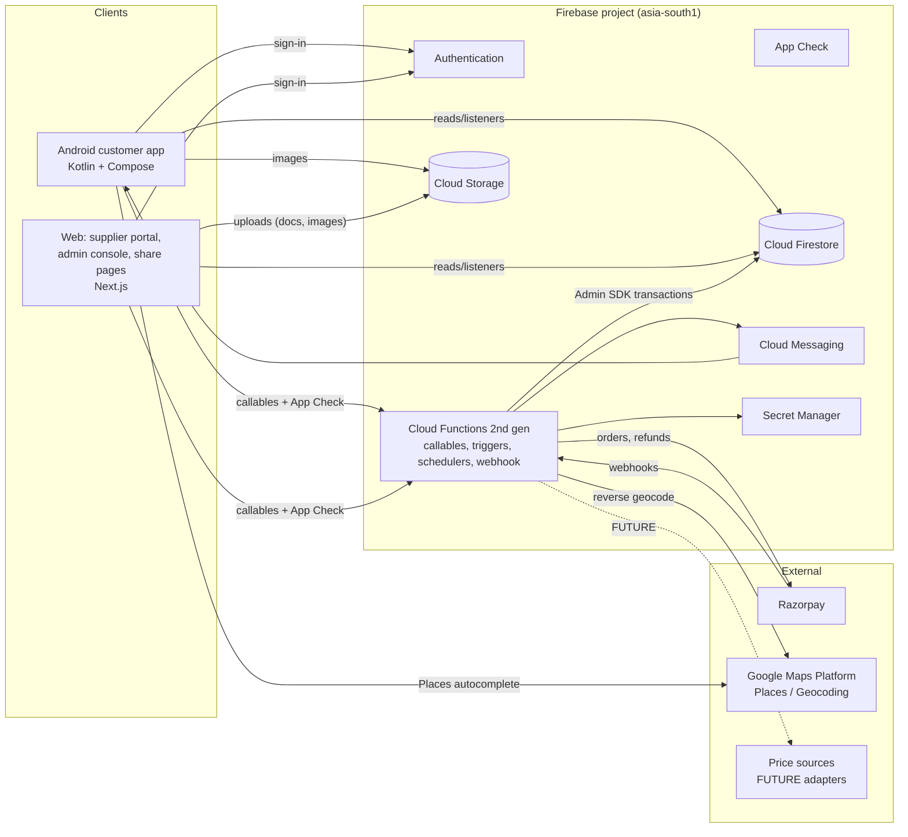

### 2. Logical architecture (bounded contexts)

| Context | Owns (collections) | Key operations |
|---|---|---|
| Identity | `users`, claims, `suppliers` | sign-in hooks, roles, supplier verification |
| Locality | `localities` | resolve, search, set user locality |
| Catalogue | `deals` | propose, approve, schedule groups |
| Group buying | `groups`, `groups/*/members`, `priceHistory`, `activity` | join, leave, lock, state |
| Pricing | `@groupdeal/pricing` (pure) | quote, validate, final price |
| Auction | `auctions`, `bids`, `revisions` | open, bid, close, award |
| Orders | `orders` | create at award, track, cancel |
| Payments | `payments`, `paymentEvents` | create order, verify, webhook, refund, reconcile |
| Engagement | `requests`, `votes`, `users/*/watchlist`, `users/*/notifications` | request, vote, notify |
| Trust & safety | `ratings`, `disputes`, `fraudSignals`, `adminActions` | rate, dispute, signal, audit |

### 3. Trust boundaries

| Value / operation | Trusted source | Never accepted from a client |
|---|---|---|
| Member count, units committed | Firestore transaction in `joinGroup`/`leaveGroup` | Any count, tier or price |
| Unit price, tier, savings | `@groupdeal/pricing` inside the function | Client-computed price |
| Locked/final price, order amount | Lock and award functions | Amount in `createPaymentOrder` |
| Payment success | Server signature check + Razorpay fetch, or verified webhook | SDK success callback alone |
| Auction winner | `closeAuctions` scheduled function | Supplier-declared result |
| Role, supplier status | Custom claims set by admin functions | Role field in profile |
| Trust score | Server recompute | Any client value |
| Locality of a user | Server-set `localityId` | Arbitrary locality in join requests (server reads profile) |
| Timestamps | `FieldValue.serverTimestamp()` | Client clocks |

**Authorisation happens in two places:** Firestore rules (reads, self-owned writes) and function guards (`requireAuth`, `requireRole`, `requireVerifiedSupplier`, ownership checks). App Check is enforced on both.

### 4. Responsibilities

**Android client:** render state, collect input, call functions with `requestId`, show estimates labelled as such, cache, handle Razorpay checkout UI, register FCM token.
**Web client:** supplier/admin UIs, SSR public share pages (read-only Admin SDK), same callables.
**Functions:** all invariants, money, deadlines, notifications, external APIs, audit, idempotency.

### 5. Core flows

#### 5.1 Authentication
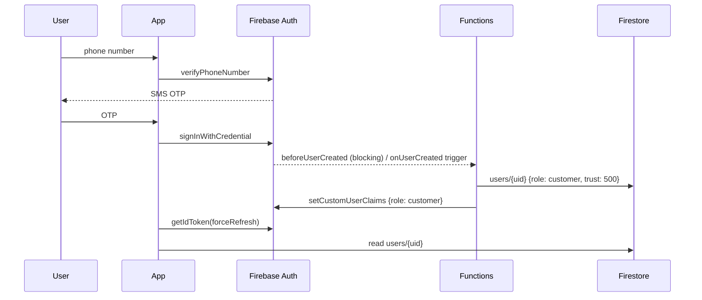

#### 5.2 Join group (authoritative)
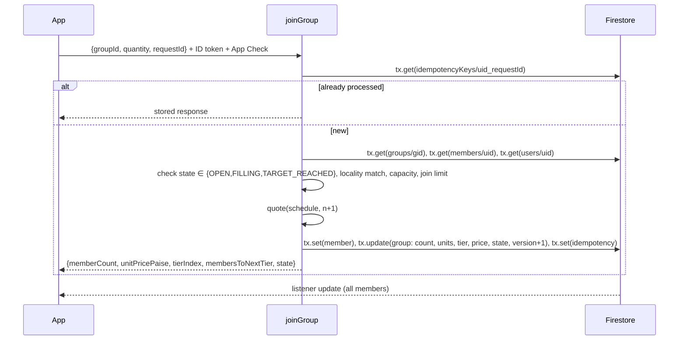

#### 5.3 Pricing / tier change side effects
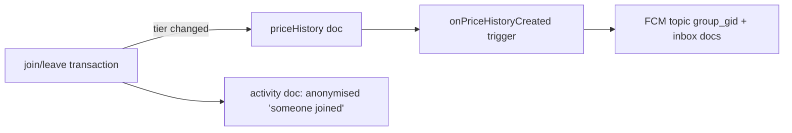

#### 5.4 Purchase lifecycle
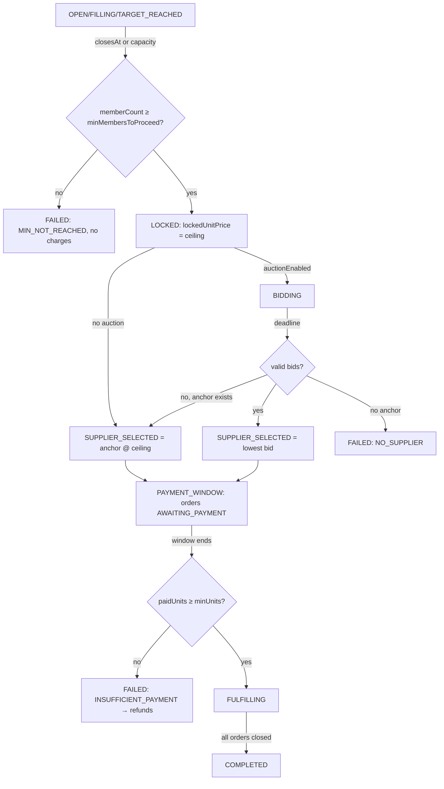

#### 5.5 Supplier auction
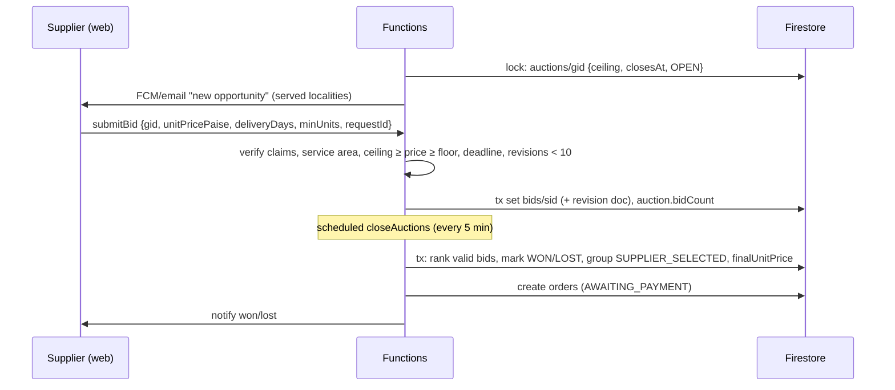

#### 5.6 Payment
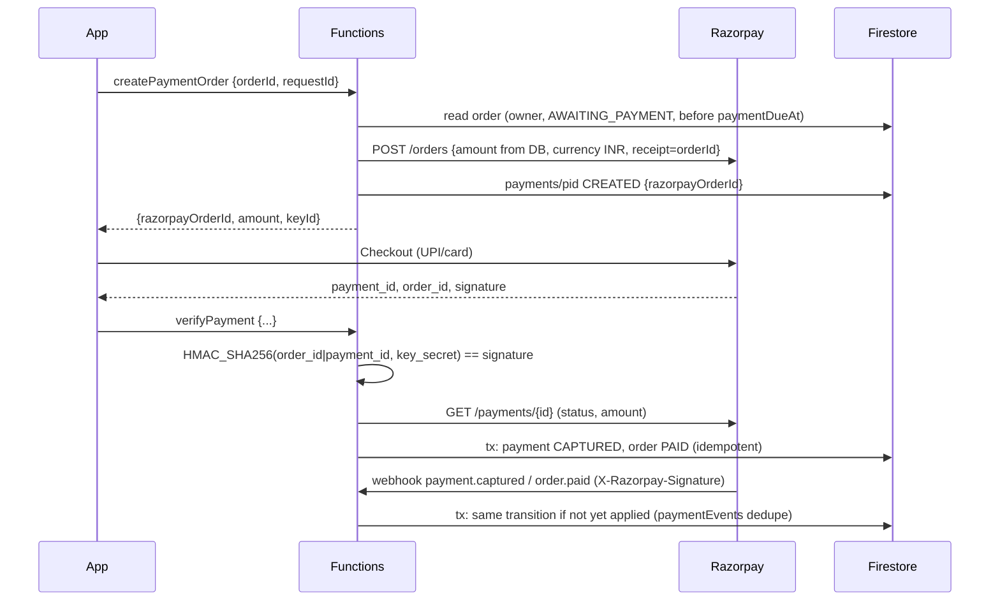

#### 5.7 Notifications
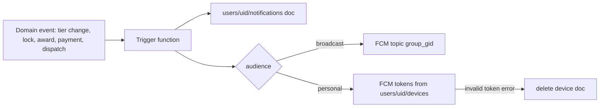

### 6. Component map (deployable units)

| Unit | Tech | Deploy |
|---|---|---|
| `android` | Kotlin, Compose, Hilt, Firebase SDKs, Razorpay SDK, Places SDK | Play Console (internal → closed → production) |
| `web` | Next.js (App Router), TypeScript, Tailwind, Firebase JS SDK, Admin SDK (server) | Firebase App Hosting |
| `functions` | TypeScript, Node 20, firebase-functions v2, firebase-admin, razorpay | `firebase deploy --only functions` |
| `packages/pricing` | TypeScript, zero dependencies | Built into functions and web |
| `firestore` | rules, indexes, rules tests | `firebase deploy --only firestore` |


### 1. Projects and environments
| Project ID (proposed) | Purpose | Data |
|---|---|---|
| `groupdeal-dev` | Local development against emulators + shared dev | Synthetic |
| `groupdeal-staging` | Pre-release testing, Razorpay **test** keys | Synthetic |
| `groupdeal-prod` | Production, Razorpay **live** keys | Real |
Each has its own `google-services.json` (Android flavor), web config, App Check providers and secrets. Production access is limited to two maintainers with MFA.

### 2. Services used
| Service | Use | Notes |
|---|---|---|
| Authentication | Phone OTP, Google; blocking functions for claims | SMS quota/billing on Blaze |
| Firestore (Native, asia-south1) | All application data | PITR enabled in prod (verify plan) |
| Cloud Functions 2nd gen (Node 20, TS) | Callables, triggers, schedulers, webhook | Secrets via `defineSecret` |
| Cloud Scheduler | Sweepers (5 min), reconciliation (daily) | Created by `onSchedule` |
| Cloud Storage | Images, supplier documents, dispute photos | Storage rules |
| Cloud Messaging | Push | Topics + tokens |
| App Check | Play Integrity (Android), reCAPTCHA Enterprise (web) | Enforced in staging & prod |
| Crashlytics, Performance, Analytics | Android/web telemetry | No PII in events |
| App Hosting | Next.js web | Separate backends per env |
| Secret Manager | Razorpay key secret, webhook secret, Maps server key | Never in code or client |

### 3. Function inventory
| Name | Type | Trigger | Purpose |
|---|---|---|---|
| `onUserCreated` | Auth (blocking `beforeUserCreated` + doc create) | sign-up | create `users/{uid}`, claim `role=customer` |
| `updateProfile` | callable | client | display name, photo, preferences |
| `resolveLocality` | callable | client | lat/lng → nearest active locality (server Geocoding) |
| `setUserLocality` | callable | client | set locality + collection point, rate-limited |
| `joinGroup` / `leaveGroup` / `setQuantity` | callable | client | transactional membership |
| `createRequest` / `voteRequest` / `unvoteRequest` | callable | client | demand |
| `toggleWatch` | callable | client | optional (rules allow direct write too) |
| `createPaymentOrder` / `verifyPayment` | callable | client | payments |
| `cancelOrder` | callable | client | before payment only |
| `submitRating` / `raiseDispute` | callable | client | trust & safety |
| `supplierRegister` / `supplierUpdateServiceAreas` / `supplierProposeDeal` | callable | web | supplier |
| `submitBid` / `withdrawBid` | callable | web | auction |
| `supplierUpdateFulfilment` | callable | web | order tracking |
| `admin*` (VerifySupplier, SetRole, ApproveDeal, OpenGroup, CancelGroup, ExtendGroup, ConvertRequest, InvalidateBid, RefundOrder, ResolveDispute, UpsertLocality, UpdateConfig, SuspendUser) | callable | web | admin, all audited (full names `adminVerifySupplier` …) |
| `sweepGroups` | schedule 5 min | | lock due groups, fail below minimum, open auctions |
| `sweepAuctions` | schedule 5 min | | close due auctions, award, create orders |
| `sweepPaymentWindows` | schedule 5 min | | default unpaid, fail/advance groups, trigger refunds |
| `reconcilePayments` | schedule daily 02:00 IST | | Razorpay ↔ Firestore reconciliation |
| `razorpayWebhook` | HTTPS onRequest | Razorpay | verified events |
| `onPriceHistoryCreated` | Firestore trigger | tier change | notify topic + watchers |
| `onOrderStatusChanged` | Firestore trigger | order update | notify customer/supplier |
| `onRatingCreated` | Firestore trigger | rating | update supplier score, customer trust |
| `onRequestThresholdReached` | Firestore trigger | request update | notify admins |
| `detectFraudSignals` | Firestore triggers + schedule | votes/joins/payments | write `fraudSignals` |
| `rollupDailyStats` | schedule daily 01:00 IST | | analytics roll-ups into `stats/daily` |
| `createOrdersForGroup` | internal (called after award) | | idempotent order creation, IDs `{gid}_{uid}` |

All callables: `region: 'asia-south1'`, `enforceAppCheck: true` (staging/prod), `consumeAppCheckToken: true` for payment and bid functions (replay protection), input validated with a schema library (zod), structured logging with `requestId`.

### 4. Sweeper design (idempotent)
Each sweep queries due documents (`state == X && closesAt <= now`, limit 200), processes each in its **own transaction** that re-reads and re-checks the condition, so overlapping runs and retries are safe. Long backlogs are drained over successive runs. A per-document `processingLease` field is not needed because transactions are the guard.

### 5. Security layers
1. Firebase Auth (identity) → 2. App Check (genuine client) → 3. Firestore/Storage rules (read/self-write scope) → 4. Function guards (role, ownership, state) → 5. Transactions (invariants) → 6. Audit logs. See SECURITY.md.

### 6. Emulator-first development
`firebase emulators:start --only auth,firestore,functions,storage` with seeded data (`/scripts/seed.ts`), App Check debug provider, Razorpay calls stubbed by an injected `PaymentGateway` interface (real test-mode calls only in staging).


### 1. Stack
Kotlin 2.2.x · Jetpack Compose (latest stable BOM at Stage 0) · Material 3 · Navigation Compose (type-safe routes) · Hilt · Coroutines/Flow/StateFlow · Firebase BoM (Auth, Firestore, Functions, Messaging, App Check Play Integrity, Crashlytics, Analytics, Performance) · Razorpay Checkout SDK · Places SDK · Coil 3 · Room · DataStore (preferences) · JUnit 5/JUnit 4, MockK, Turbine, Compose UI test, Robolectric. Retrofit is **not** used in MVP (D-12). Versions are pinned in `gradle/libs.versions.toml` at Stage 0 (exact versions NOT VERIFIED here).

### 2. Modules
```
:app                       – Application, MainActivity, NavHost, Hilt entry, flavors dev/staging/prod
:core:model                – pure Kotlin domain models (Group, Tier, Order, Money(paise)…)
:core:domain               – use cases + PricingEngine port (pure Kotlin, golden-vector tested)
:core:data                 – repository implementations (Firestore, Functions, Room, DataStore), DTO mappers
:core:database             – Room DB, DAOs, entities (local-only data, D-13)
:core:network              – FunctionsClient wrapper (requestId, retry policy, error mapping), App Check setup
:core:designsystem         – theme (emerald), typography, components (PriceTag, TierRoadmap, ProgressMeter…)
:core:ui                   – shared composables (ErrorState, EmptyState, OfflineBanner), UiState helpers
:core:testing              – fakes, test dispatchers, golden vectors resource
:feature:auth              – phone OTP, Google, profile setup
:feature:locality          – permission rationale, resolve, picker
:feature:home              – rails, demand banner
:feature:discover          – feed, search, filters
:feature:group             – deal detail, join sheet, progress, leave
:feature:requests          – list, create, vote
:feature:orders            – list, detail, payment, tracking, rating, dispute
:feature:notifications     – inbox
:feature:profile           – profile, savings, settings, watchlist
```
Dependency rule: `feature → core:domain, core:ui, core:designsystem`; only `core:data` touches Firebase; `core:domain` has no Android dependencies.

### 3. Layering
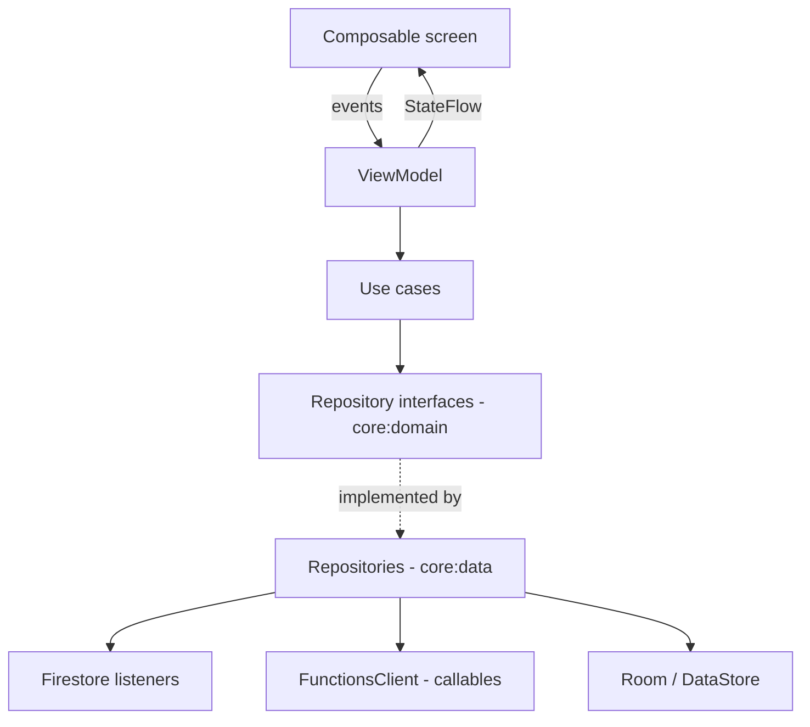
Example: `JoinGroupUseCase(groupId, qty)` → `GroupRepository.join()` → `FunctionsClient.call("joinGroup", payload + requestId)` → maps `HttpsError` to `JoinError` sealed class.

### 4. State model
Each screen: `sealed interface XUiState { Loading; Content(...); Error(message, retry) ; Offline(cached?) }`. ViewModels expose `StateFlow` via `stateIn(viewModelScope, WhileSubscribed(5_000), Loading)`. One-off effects (navigation, snackbars) through `Channel`/`SharedFlow`. Firestore snapshot flows use `callbackFlow` with `awaitClose`, and drop snapshots whose `version` is lower than the last rendered one.

### 5. Key implementations
- **FunctionsClient:** generates `requestId` per user action (stored in the ViewModel so a retry reuses it), retry policy from API_SPECIFICATION.md, timeout 15 s, maps errors.
- **Pricing preview:** `PricingEngine.quote()` (Kotlin port) for "if you join, price becomes…" hints; always labelled as estimate; never sent to the server.
- **Payments:** `PaymentActivity` hosts Razorpay Checkout (`order_id`, key ID from server); on result, calls `verifyPayment` and then observes `orders/{id}` until PAID/failed.
- **Notifications:** `FirebaseMessagingService` stores token to `users/{uid}/devices/{installationId}`; subscribes to `group_<gid>` topics on join if the user enabled tier alerts; deep links `groupdeal://group/{gid}`, `groupdeal://order/{oid}`.
- **Location:** coarse location only (`ACCESS_COARSE_LOCATION`); lat/lng sent once to `resolveLocality`, never persisted.
- **App Check:** Play Integrity provider in staging/prod; debug provider in dev flavor.
- **Offline:** Firestore persistence on; `OfflineBanner` driven by `ConnectivityManager`; mutation buttons disabled offline.

### 6. Build variants
Flavors `dev` (emulators, debug App Check), `staging` (staging project, Razorpay test), `prod`. Separate `applicationIdSuffix` for dev/staging so all can be installed together. R8 full mode + resource shrinking in release; Crashlytics mapping upload in CI.

### 7. Quality gates
ktlint/detekt, Android Lint (warnings as errors for security checks), unit tests (domain + ViewModels with MockK/Turbine), Compose UI tests for critical flows, golden-vector parity test, baseline profiles (V1).


### 1. Stack
Next.js (App Router) · TypeScript (strict) · React · Tailwind CSS · Firebase JS SDK (Auth, Firestore, Functions, App Check reCAPTCHA Enterprise) · Firebase Admin SDK on the server (read-only use) · zod · TanStack Query for callable mutations · Vitest + Testing Library · Playwright E2E. Hosting: Firebase App Hosting (D-18).

### 2. Route map
| Route | Access | Rendering |
|---|---|---|
| `/` | public | static marketing page |
| `/g/[groupId]` | public | SSR (Admin SDK read of the group snapshot), Open Graph tags for sharing; CTA "Open in app" (Android App Link) |
| `/login` | public | client |
| `/supplier/onboarding`, `/supplier/verification` | supplier (any status) | client |
| `/supplier` (dashboard), `/supplier/opportunities`, `/supplier/auctions/[gid]`, `/supplier/bids`, `/supplier/fulfilment`, `/supplier/analytics`, `/supplier/profile` | verified supplier | client + server components |
| `/admin` and `/admin/{users,suppliers,localities,deals,groups,requests,auctions,orders,payments,disputes,moderation,fraud,analytics,settings}` | admin | server components for lists (session cookie verified), client for actions |

### 3. Auth model
Client signs in with Firebase Auth; a route handler exchanges the ID token for a **Firebase session cookie** (httpOnly, secure, SameSite=Strict, 5 days). `middleware.ts` redirects unauthenticated users; server components verify the cookie with the Admin SDK and check claims (`role`, `supplierStatus`). **All mutations still go through callable functions** (the web server never writes business data), keeping one authorisation path for Android and web.

### 4. Structure
```
web/
  app/(public)/… app/(supplier)/supplier/… app/(admin)/admin/… app/api/session/route.ts
  components/ui (Button, Table, Badge, Dialog…) components/domain (TierRoadmap, AuctionCard, BidForm, OrderTable…)
  lib/firebase/{client.ts,admin.ts} lib/callables.ts (typed wrappers + requestId) lib/money.ts (paise formatting)
  lib/pricing → re-exports @groupdeal/pricing
```

### 5. UX rules
Responsive (mobile-first for suppliers on phones; admin optimised for ≥ 1280 px). Tables with server pagination. Every destructive admin action requires a reason dialog. Dark mode via Tailwind `class` strategy. Accessibility: semantic HTML, focus management in dialogs, axe checks in CI.

### 6. Security
CSP with nonces, `X-Frame-Options: DENY`, strict referrer policy; no secrets in `NEXT_PUBLIC_*` except the Firebase web config and reCAPTCHA site key; Admin SDK credentials via App Hosting service identity (no JSON keys).


---

# C. Complete Feature Map (Product Requirements)


**Product:** GroupDeal — *Buy Together, Save More* — locality-based group buying with dynamic pricing and supplier bidding.
**Platforms:** Android customer app; web supplier portal, admin console and public deal pages (D-11).
**Release labels:** **MVP** (first production release), **V1** (next), **FUTURE**.

### 1. Roles

| Role | Who | Authenticated by | Can |
|---|---|---|---|
| Customer | Resident buying for a household | Phone OTP / Google (Android) | Browse their locality, join/leave groups, request/upvote products, pay, track, rate, raise disputes |
| Supplier | Farm co-op, wholesaler, brand | Phone OTP / Google (web) + **admin verification** | Propose deals (anchor supplier), bid in auctions for their service areas, fulfil orders, view analytics |
| Admin | Platform operator | Google (web) + `role=admin` claim | Verify suppliers, approve deals, open groups, manage localities, moderate, refund, resolve disputes, configure |

A user has exactly one role. Supplier accounts are separate from customer accounts (a person who is both uses two sign-ins). This keeps rules simple and audit trails clean.

### 2. Customer journey (Android)

| # | Step | Requirement | Release |
|---|---|---|---|
| C1 | Onboarding | 3 intro cards (how group pricing works, pay after lock, collection-point delivery). Skippable. | MVP |
| C2 | Authentication | Phone OTP (primary), Google (secondary). New user → profile (name; phone from auth). | MVP |
| C3 | Locality | Ask for coarse location permission with rationale; on grant, `resolveLocality(lat,lng)`; on deny, pincode/area search. User confirms locality and collection point. Change anytime (max 3 changes/30 days). | MVP |
| C4 | Home | Locality header; "Closing soon", "Almost at next tier", "New in your area" rails; demand banner. | MVP |
| C5 | Discovery | List of OPEN/FILLING/TARGET_REACHED groups in the locality; category chips; search by product/brand; sort by closing time, savings, momentum. | MVP |
| C6 | Deal detail | Images, MRP, current price, savings %, tier roadmap with active tier, members x/target, members to next tier, countdown, supplier (anchor) name and rating, delivery terms, quantity picker (1..max). | MVP |
| C7 | Join | Confirm sheet: quantity, current price **estimate**, "final price is set when the group closes and can only go down", pay-after-lock explanation. Join returns the authoritative new state. | MVP |
| C8 | Progress | Live member count and price via listener; tier-crossing animation; push when tier changes (opt-in). | MVP |
| C9 | Leave | Allowed before lock; warns if leaving drops the tier. | MVP |
| C10 | Lock & auction wait | Status "Locked at ₹949 — suppliers are bidding, price can only go down". | MVP |
| C11 | Payment | On SUPPLIER_SELECTED: order created; pay within the window via Razorpay (UPI/card/netbanking). Status screen polls server, never trusts SDK callback alone. | MVP |
| C12 | Tracking | Order timeline: Paid → Supplier confirmed → Dispatched → Ready at collection point → Delivered. | MVP |
| C13 | Notifications | Inbox + push: tier reached, closing soon (watchlist), group locked, supplier selected + pay now, payment confirmed, dispatched, ready for pickup, refund issued. | MVP |
| C14 | Rating | After DELIVERED: 1–5 stars + optional text for supplier; once per order. | MVP |
| C15 | Requests | Request a product (name, category, target price, reference price); upvote others (one vote each). | MVP |
| C16 | Watchlist | Save groups; get "closing soon" reminder. | V1 |
| C17 | Savings dashboard | Lifetime and monthly savings vs MRP. | V1 |
| C18 | Disputes | Raise issue on a delivered/paid order (missing, damaged, wrong item). | MVP |

### 3. Supplier journey (web portal)

| # | Step | Requirement | Release |
|---|---|---|---|
| S1 | Registration | Business name, GSTIN (optional MVP), FSSAI licence for food (upload), contact, bank details placeholder for settlement. | MVP |
| S2 | Verification | Admin reviews documents → VERIFIED / REJECTED (reason). Only VERIFIED suppliers bid or propose deals. | MVP |
| S3 | Service area | Select localities served + max delivery days per locality. | MVP |
| S4 | Propose deal | Product, images, MRP, base price, 1–5 tiers, `maxQtyPerMember`, capacity, duration, delivery terms. Becomes **anchor supplier** (committed to deliver at the locked price). Admin approval required. | MVP |
| S5 | Opportunities | Auctions in BIDDING for served localities: product, units committed, ceiling price, deadline. | MVP |
| S6 | Bid | Unit price (≤ ceiling, ≥ floor), delivery days, `minUnits`. Revise or withdraw before deadline (max 10 revisions). Sealed. | MVP |
| S7 | Result | Won/lost notification; won → fulfilment list. | MVP |
| S8 | Fulfilment | Confirm order batch, mark dispatched, mark ready at collection point, mark delivered per order. | MVP |
| S9 | Analytics | Bids won/lost, revenue, ratings, on-time rate. | V1 |

### 4. Admin journey (web console)

| Area | Capabilities | Release |
|---|---|---|
| Users | Search, view, suspend/unsuspend, view trust history | MVP |
| Suppliers | Verify/reject/suspend, view documents and performance | MVP |
| Localities | Create/edit registry (pincode, name, collection points, active flag) | MVP |
| Deals | Approve/reject supplier proposals, create admin deals, pause/archive | MVP |
| Groups | Open groups per locality, extend deadline (once), cancel with reason | MVP |
| Requests | Review THRESHOLD_REACHED requests, convert to deal, reject | MVP |
| Auctions/bids | View all bids, invalidate a bid with reason (audited) | MVP |
| Orders/payments | View, initiate refunds, view reconciliation exceptions | MVP |
| Disputes | Assign, resolve (refund/partial refund/reject) | MVP |
| Moderation | Hide requests/ratings that violate policy | MVP |
| Fraud signals | Review queue (vote bursts, device reuse, amount mismatch) | V1 |
| Analytics | GMV, groups closed/failed, avg savings, payment conversion | V1 |
| Configuration | Fees, thresholds, windows, feature flags (`config/app`) | MVP |

Every admin action writes an `adminActions` audit record.

### 5. Functional requirements (summary)

FR-01 Auth by phone OTP/Google · FR-02 Locality resolution and change limits · FR-03 Locality-scoped group feed · FR-04 Search/filter/sort · FR-05 Deal detail with tier roadmap · FR-06 Transactional join/leave with quantity · FR-07 Server-computed price, tier, savings, next tier · FR-08 Lock at deadline/capacity, fail below minimum · FR-09 Sealed reverse auction with ceiling · FR-10 Orders created at supplier selection · FR-11 Razorpay payment with server verification and webhooks · FR-12 Payment window, defaults, refunds · FR-13 Order tracking · FR-14 Push + inbox notifications · FR-15 Ratings and trust score · FR-16 Requests and one-vote-per-user upvotes, conversion to deals · FR-17 Supplier onboarding/verification · FR-18 Admin console with audit · FR-19 Disputes · FR-20 Public shareable deal page.

### 6. Non-functional requirements

| ID | Requirement |
|---|---|
| NFR-01 Correctness | Price is a pure function of (schedule, memberCount); golden vectors pass on server, web and Android. |
| NFR-02 Consistency | All clients show the server's price; displayed estimates are labelled. |
| NFR-03 Security | No client-trusted money values; App Check enforced; least-privilege rules. |
| NFR-04 Idempotency | Every mutation and webhook is safe to retry. |
| NFR-05 Availability | Payment and join paths degrade gracefully (clear errors, retries); no silent data loss. |
| NFR-06 Privacy | Store locality, not precise location; members lists not public; DPDP Act 2023 obligations reviewed before launch (**NOT VERIFIED** legal review). |
| NFR-07 Accessibility | TalkBack labels, 48dp targets, contrast ≥ WCAG AA, dynamic type. |
| NFR-08 Localisation | English MVP; Tamil, Hindi V1. |
| NFR-09 Observability | Structured logs with request IDs; Crashlytics; alerting on payment/webhook failures. |
| NFR-10 Compatibility | Android 7.0 (API 24)+; web: last 2 versions of Chrome, Edge, Firefox, Safari. |
| NFR-11 Performance | Targets set after baseline measurement in staging (no numbers asserted here). |

### 7. Out of scope (V1)
iOS app; courier integration; credit/BNPL; multi-product carts; supplier price negotiations outside auctions.


---

# D. Firestore / Data Model


Conventions: money = integer paise (D-03); timestamps = Firestore `Timestamp` set by the server; `*` = required; **S** = server-only field (clients can never write it; for most collections clients can't write at all). Every server-written document carries audit fields `createdAt*`, `updatedAt*` and, where state changes, `stateHistory` is kept in a sub-collection or array (bounded).

### 0. Design reasoning
- **Groups, not deals, carry live state.** A deal is reusable; each locality round is a group with its own count, price and auction (D-04). This bounds write contention to one locality round.
- **Members as a sub-collection** (`groups/{gid}/members/{uid}`): doc ID = uid makes "one membership per user" a structural guarantee and lets the join transaction read exactly one doc.
- **Bids keyed by supplier** (`auctions/{gid}/bids/{supplierId}`): one live bid per supplier; revisions in a child collection for audit.
- **Votes keyed by user** (`requests/{rid}/votes/{uid}`): one vote per user, structurally.
- **Denormalised snapshots** on groups and orders (ADR-12).
- **No `orderItems`:** an order is one product from one group; quantity lives on the order. Multi-product carts are out of scope.
- **Watchlist = favorites** (one concept, `users/{uid}/watchlist`).
- **Activity logs** are split: public anonymised `groups/{gid}/activity`; private `adminActions`; operational logs in Cloud Logging (not Firestore).

### 1. `config/app`  (server/admin-managed)
| Field | Type | Default | Notes |
|---|---|---|---|
| platformFeeBps* | int | 0 | basis points charged to supplier at settlement |
| deliveryFeePaise* | int | 0 | added per order |
| maxQtyPerMemberDefault* | int | 3 | |
| paymentWindowHours* | int | 24 | |
| auctionDurationHoursDefault* | int | 6 | |
| bidFloorPercentOfMrp* | int | 30 | bids below floor are rejected and flagged |
| maxBidRevisions* | int | 10 | |
| maxJoinCyclesPerGroup* | int | 3 | D-20 |
| requestVoteThresholdDefault* | int | 15 | per-category override map `requestThresholds` |
| fillingRatio* | number | 0.6 | FILLING state threshold |
| localityChangeLimit30d* | int | 3 | |
| features* | map<string,bool> | | feature flags |

### 2. `users/{uid}`
| Field | Type | Req | Writer | Notes |
|---|---|---|---|---|
| displayName | string ≤ 60 | * | user | |
| phone | string E.164 | | S | from Auth |
| email | string | | S | Google sign-in |
| photoUrl | string | | user | Storage path |
| role | enum customer/supplier/admin | * | S | mirror of claim, display only |
| localityId | string | | S | set by `setUserLocality` |
| collectionPointId | string | | S | |
| geohash5 | string(5) | | S | coarse only |
| localityChanges | array<Timestamp> (≤ 5) | | S | rate limit |
| trust | map {score:int 0–1000, tier:enum, completed:int, defaults:int, onTimePayRate:int%} | * | S | |
| preferences | map {notifyTierChange:bool, notifyClosingSoon:bool, language:enum en/ta/hi} | | user | |
| status | enum ACTIVE/SUSPENDED | * | S | |
| createdAt, updatedAt | Timestamp | * | S | |

Sub-collections: `devices/{deviceId}` {fcmToken, platform, appVersion, updatedAt} (user-writable, own only) · `notifications/{nid}` {type, title, body, deepLink, groupId?, orderId?, createdAt, readAt?} (server writes, user may set `readAt`) · `watchlist/{groupId}` {addedAt}.

**Lifecycle:** created by auth trigger → ACTIVE → SUSPENDED (admin). Deletion request → anonymise PII, keep orders for accounting (retention per legal review, NOT VERIFIED).

### 3. `suppliers/{supplierUid}`
| Field | Type | Req | Notes |
|---|---|---|---|
| businessName* | string | * | |
| contactName, phone, email | string | * | |
| gstin | string | | validated format |
| fssaiLicenceNo | string | food * | |
| documents | array<{type, storagePath, uploadedAt}> | * | Storage `supplier-docs/{uid}/...`, admin-read only |
| status* | enum PENDING/VERIFIED/REJECTED/SUSPENDED | * | S; mirrored to claim `supplierStatus` |
| rejectionReason | string | | S |
| serviceAreas | array<{localityId, maxDeliveryDays}> (≤ 50) | * | via `supplierUpdateServiceAreas` |
| serviceLocalityIds | array<string> | * | S, derived for `array-contains` queries |
| score | map {rating:int x100, ratingCount, onTimeRate:int%, wins:int, fulfilled:int} | * | S |
| settlement | map {mode: MANUAL/ROUTE, routeAccountId?} | | S, admin |

### 4. `localities/{localityId}`  e.g. `IN-560034`
| Field | Type | Notes |
|---|---|---|
| pincode* | string(6) | |
| name* | string | "Koramangala" |
| city*, state* | string | |
| geohash5* | string | centroid |
| collectionPoints | array<{id, name, address, hours}> | |
| active* | bool | only active localities are selectable |
| stats | map {openGroups:int, openRequests:int} | S, maintained by triggers |

### 5. `deals/{dealId}`
| Field | Type | Req | Notes |
|---|---|---|---|
| title, description, brand, category* | string | * | category enum list in config |
| images | array<storagePath> (≤ 6) | * | |
| unit* | string | * | "1 L jar" |
| mrpPaise*, basePricePaise* | int | * | |
| tiers* | array<{minMembers:int, unitPricePaise:int}> (1–5) | * | must pass `validateSchedule` |
| scheduleVersion* | int | * | increments on edit |
| maxQtyPerMember* | int 1–10 | * | |
| capacity* | int | * | max members per group (supply cap) |
| minMembersToProceed* | int | * | default tiers[0].minMembers |
| targetMembers* | int | * | default top tier threshold (display goal) |
| groupDurationHours* | int | * | |
| auctionEnabled* | bool | * | |
| auctionDurationHours | int | | |
| anchorSupplierId | string | | proposing supplier; null for admin deals from requests |
| eligibleLocalityIds* | array<string> | * | |
| deliveryTerms | map {maxDeliveryDays:int, collectionPointOnly:bool} | * | |
| referencePricePaise | int | | admin-verified market reference (D-19) |
| sourceRequestId | string | | if converted from a request |
| status* | enum DRAFT/PENDING_REVIEW/ACTIVE/PAUSED/ARCHIVED/REJECTED | * | S |

### 6. `groups/{groupId}`  (public read)
| Field | Type | Writer | Notes |
|---|---|---|---|
| dealId*, localityId*, category* | string | S | |
| deal* | map snapshot {title, brand, unit, imagePath, mrpPaise, basePricePaise, tiers, scheduleVersion, maxQtyPerMember} | S | frozen at creation |
| anchorSupplier | map {id, name, rating} | S | |
| memberCount* | int ≥ 0 | S | active members only |
| unitsCommitted* | int ≥ 0 | S | |
| capacity*, minMembersToProceed*, targetMembers* | int | S | copied from deal |
| currentTierIndex* | int (-1..n) | S | |
| currentUnitPricePaise* | int | S | |
| savingsPercent* | int | S | |
| membersToNextTier | int \| null | S | never negative |
| state* | enum (STATE_MACHINES §2) | S | |
| failureReason | enum MIN_NOT_REACHED/NO_SUPPLIER/INSUFFICIENT_PAYMENT/ADMIN_CANCELLED | S | |
| opensAt*, closesAt* | Timestamp | S | |
| lockedAt, lockedTierIndex, lockedUnitPricePaise | | S | ceiling |
| auctionClosesAt | Timestamp | S | |
| selectedSupplier | map {id, name, bidUnitPricePaise, deliveryDays, minUnits} | S | |
| finalUnitPricePaise | int | S | ≤ lockedUnitPricePaise |
| paymentDueAt | Timestamp | S | |
| paidUnits, paidMembers | int | S | |
| version* | int | S | +1 on every write; used for stale detection |

Sub-collections:
- `members/{uid}` {uid*, quantity* 1..max, status* ACTIVE/LEFT/COMMITTED/PAID/DEFAULTED/RELEASED/REFUNDED (transitions in STATE_MACHINES §3), joinCycles*, joinedAt*, leftAt?, orderId?} — read: self/admin.
- `priceHistory/{autoId}` {fromTier, toTier, unitPricePaise, memberCount, at} — public; written only when the tier changes.
- `activity/{autoId}` {type JOINED/LEFT/TIER_UNLOCKED/LOCKED/SUPPLIER_SELECTED, memberCount, at} — public, **no user identifiers**.

**Lifecycle:** created by `adminOpenGroup` (or scheduled from deal) → state machine → COMPLETED/FAILED/CANCELLED; archived after 180 days (still readable).

### 7. `auctions/{groupId}`
| Field | Type | Notes |
|---|---|---|
| groupId*, dealId*, eligibleLocalityId* | string | |
| status* | enum OPEN/CLOSING/AWARDED/NO_VALID_BIDS/CANCELLED | |
| ceilingPaise*, floorPaise* | int | |
| unitsCommitted* | int | |
| opensAt*, closesAt* | Timestamp | |
| bidCount* | int | visible to suppliers |
| winningSupplierId | string | |
| closedAt | Timestamp | |

`bids/{supplierId}` {supplierId*, unitPricePaise*, deliveryDays*, minUnits*, status* ACTIVE/WITHDRAWN/INVALIDATED/WON/LOST, revision*, priceSetAt*, firstSubmittedAt*, updatedAt*, invalidationReason?} · `bids/{sid}/revisions/{n}` {unitPricePaise, deliveryDays, minUnits, action SUBMIT/REVISE/WITHDRAW, at, requestId}.

### 8. `orders/{orderId}`
| Field | Type | Notes |
|---|---|---|
| uid*, groupId*, dealId*, supplierId*, localityId*, collectionPointId* | string | |
| product* | map {title, unit, imagePath} | snapshot |
| quantity* | int | |
| unitPricePaise*, deliveryFeePaise*, amountPaise* | int | amount = unit × qty + fee |
| mrpPaise*, savedPaise* | int | saved = (mrp − unit) × qty |
| status* | enum (STATE_MACHINES §7) | |
| paymentDueAt* | Timestamp | |
| paymentId | string | |
| tracking | array<{status, at, note?}> (≤ 20) | |
| rated | bool | |
| refund | map {status, amountPaise, razorpayRefundId?, reason} | |

### 9. `payments/{paymentId}`
{orderId*, uid*, amountPaise*, currency* "INR", razorpayOrderId*, razorpayPaymentId?, status* (STATE_MACHINES §8), method?, attempts*, lastError?, verifiedBy (CLIENT_SIGNATURE+FETCH / WEBHOOK / RECONCILIATION)}.
`paymentEvents/{razorpayEventId}` {event, paymentId, receivedAt, processed:bool, payloadHash} — webhook dedupe (server-only).

### 10. `requests/{requestId}`
{localityId*, createdBy* uid, productName* (3–80), category*, targetPricePaise*, referencePricePaise*, voteCount* (S), threshold* (S), status* OPEN/THRESHOLD_REACHED/UNDER_REVIEW/CONVERTED/REJECTED/EXPIRED (S), convertedDealId?, expiresAt* (default 30 days), moderation {hidden:bool, reason?}}.
`votes/{uid}` {at}.

### 11. Other collections
- `ratings/{orderId}` {uid*, supplierId*, groupId*, stars* 1–5, text ≤ 500, createdAt*, hidden} — one per order (doc ID).
- `disputes/{disputeId}` {orderId*, uid*, type* MISSING/DAMAGED/WRONG_ITEM/OTHER, description*, photos[], status* OPEN/IN_REVIEW/RESOLVED_REFUND/RESOLVED_PARTIAL/REJECTED, resolution?, adminId?}.
- `fraudSignals/{id}` {type VOTE_BURST/DEVICE_REUSE/AMOUNT_MISMATCH/BID_ANOMALY/JOIN_CHURN, subjectType, subjectId, details map, severity, status OPEN/DISMISSED/ACTIONED, createdAt}.
- `adminActions/{id}` {adminUid*, action*, targetType*, targetId*, before?, after?, reason*, at*}.
- `idempotencyKeys/{uid}_{requestId}` {fn*, response map, createdAt*} — TTL policy 7 days.
- `rateLimits/{uid}_{key}` {tokens*, refilledAt*} — token-bucket state for `rateLimit()` guards (server-only).
- `stats/daily/{yyyy-mm-dd}` — admin analytics roll-ups written by `rollupDailyStats` (admin read).
- `config/admins` {emails: array} — admin allow-list for `requireAdmin` (server-only; never client-readable).

### 12. Indexes
Defined in `/firestore/firestore.indexes.json`: groups by (localityId, state, closesAt), (localityId, category, closesAt), (state, closesAt); auctions by (status, closesAt), (eligibleLocalityId, status, closesAt); requests by (localityId, status, voteCount desc); orders by (uid, createdAt desc), (supplierId, status, createdAt desc), (status, paymentDueAt); payments by (status, updatedAt); members collection group by (uid, status, joinedAt desc) for "My Groups".

TTL policies: `idempotencyKeys.createdAt` (7 days), `users/*/notifications.createdAt` (90 days).

### 13. Storage layout
`deal-images/{dealId}/{n}.webp` (public read via signed/download URLs) · `supplier-docs/{uid}/{file}` (owner write, admin read) · `dispute-photos/{disputeId}/{n}.jpg` (owner write, admin read) · `avatars/{uid}.webp`. Storage rules restrict content type and size (images ≤ 5 MB, docs ≤ 10 MB).


---

# E. Pricing Engine Specification


Implementation: `/packages/pricing/src/engine.ts` (TypeScript, zero dependencies, **executed and tested** — 6/6 tests pass against `golden-vectors.json`). Android ports the same functions in Kotlin (`core/domain/pricing/PricingEngine.kt`) for display previews and must pass the same JSON vectors in a unit test.

### 1. Model
- **Schedule** (frozen into the group at creation): `mrpPaise`, `basePricePaise`, `tiers[] = {minMembers, unitPricePaise}` ascending.
- **Metric:** active member count `n` (D-05). Quantity per member is 1..`maxQtyPerMember`; it changes `unitsCommitted`, not the tier.
- **Price rule (all-units, group-wide):** every unit of every member is charged the price of the highest tier whose `minMembers ≤ n`; below the first tier, the base price.

### 2. Validation (`validateSchedule`) — enforced when a deal is proposed/approved and when a group is opened
| Rule | Error |
|---|---|
| at least one tier | NO_TIERS |
| all money integers, > 0 | NON_INTEGER_MONEY, NON_POSITIVE_PRICE |
| base ≤ MRP | BASE_ABOVE_MRP |
| first tier price < base | FIRST_TIER_NOT_BELOW_BASE |
| first threshold ≥ 2 | THRESHOLD_BELOW_2 |
| thresholds strictly increasing | THRESHOLD_NOT_INCREASING |
| prices strictly decreasing | PRICE_NOT_DECREASING |
Additional business checks in `supplierProposeDeal`: `capacity ≥ top threshold`, `minMembersToProceed ≤ capacity`, 1 ≤ tiers ≤ 5.

### 3. Quote (`quote(schedule, n)`)
```
n ← max(0, n)                                   // never negative
tierIndex ← −1
for i in 0..tiers.size−1: if n ≥ tiers[i].minMembers then tierIndex ← i
unitPrice ← (tierIndex = −1) ? basePrice : tiers[tierIndex].unitPrice
savingsPaise ← max(0, mrp − unitPrice)
savingsPercent ← floor(savingsPaise × 100 / mrp)     // D-23: never overstate
next ← tierIndex + 1 < tiers.size ? tierIndex + 1 : none
membersToNextTier ← next = none ? null : tiers[next].minMembers − n   // > 0 always
```
Complexity O(k), k ≤ 5. Pure, deterministic, integer-only.

### 4. Worked validation — A2 Gir Cow Ghee 1 L
MRP ₹1,400 (140000 p) · base ₹1,250 · 5+ ₹1,099 · 15+ ₹949 · 30+ ₹799.

| n | Active tier | Unit price | Savings | Savings % | Members to next |
|---|---|---|---|---|---|
| 0 / negative | base | ₹1,250 | ₹150 | 10% | 5 |
| 1 | base | ₹1,250 | ₹150 | 10% | 4 |
| 4 | base | ₹1,250 | ₹150 | 10% | 1 |
| 5 | tier 1 | ₹1,099 | ₹301 | 21% | 10 |
| 14 | tier 1 | ₹1,099 | ₹301 | 21% | 1 |
| 15 | tier 2 | ₹949 | ₹451 | 32% | 15 |
| **18** | **tier 2** | **₹949** | **₹451** | **32%** | **12** |
| 29 | tier 2 | ₹949 | ₹451 | 32% | 1 |
| 30 | tier 3 | ₹799 | ₹601 | 42% | — (top) |
| 35 | tier 3 | ₹799 | ₹601 | 42% | — (top) |

At 18 members: tiers examined 5, 15, 30 → highest satisfied = 15 → ₹949. Savings ⌊(140000 − 94900) × 100 / 140000⌋ = ⌊32.2⌋ = 32%. Next tier 30 → 30 − 18 = 12. Locality saving (all qty 1) = (140000 − 94900) × 18 = 811800 p = ₹8,118. With mixed quantities, locality saving = (mrp − price) × `unitsCommitted`.

### 5. Concurrency: authoritative membership transaction
```
joinGroup(uid, groupId, quantity, requestId):            // Cloud Function, Admin SDK
  requireAuth; requireRole(customer); requireAppCheck
  validate 1 ≤ quantity ≤ group.deal.maxQtyPerMember (re-read inside tx)
  runTransaction(tx):
    idem ← tx.get(idempotencyKeys/{uid}_{requestId}); if exists → return idem.response
    g ← tx.get(groups/{groupId}); m ← tx.get(groups/{groupId}/members/{uid}); u ← tx.get(users/{uid})
    assert g.state ∈ {OPEN, FILLING, TARGET_REACHED} and now < g.closesAt           else FAILED_PRECONDITION
    assert u.localityId = g.localityId and u.status = ACTIVE                          else PERMISSION_DENIED
    assert not (m.exists and m.status = ACTIVE)                                       else ALREADY_EXISTS
    assert (m.joinCycles ?? 0) < config.maxJoinCyclesPerGroup                         else RESOURCE_EXHAUSTED
    assert g.memberCount < g.capacity                                                 else FAILED_PRECONDITION(CAPACITY)
    n ← g.memberCount + 1; units ← g.unitsCommitted + quantity
    q ← quote(g.deal, n)
    state ← n ≥ g.targetMembers ? TARGET_REACHED : (n ≥ ceil(fillingRatio × target) ? FILLING : OPEN)
    tx.set(member{uid, quantity, status: ACTIVE, joinCycles: (m.joinCycles ?? 0) + 1, joinedAt: serverTs})
    tx.update(group{memberCount: n, unitsCommitted: units, currentTierIndex: q.tierIndex,
              currentUnitPricePaise: q.unitPricePaise, savingsPercent: q.savingsPercent,
              membersToNextTier: q.membersToNextTier, state, version: g.version + 1, updatedAt: serverTs})
    if q.tierIndex ≠ g.currentTierIndex: tx.create(priceHistory{from, to, price, n, at})
    tx.create(activity{JOINED, n, at})
    if n = g.capacity: tx.update(group{lockRequested: true})        // sweeper locks within ≤ 5 min
    response ← {memberCount: n, unitPricePaise, tierIndex, membersToNextTier, state, version}
    tx.set(idempotencyKeys/{uid}_{requestId}, {fn: 'joinGroup', response, createdAt})
  return response
```
`leaveGroup` mirrors this: requires an ACTIVE membership and a pre-lock state; `n ← memberCount − 1` (assert ≥ 0), `units ← unitsCommitted − m.quantity`, recompute quote **and state** (fixes D1), member status LEFT.

`setQuantity` changes `unitsCommitted` only (no tier change), pre-lock only.

#### What the transaction guarantees
| Hazard | Prevention |
|---|---|
| Double counting (double tap, retry) | Member doc ID = uid + ACTIVE check; idempotency key returns the first response |
| Stale counts | Count is read inside the transaction; Firestore retries the transaction on contention, so the write is based on the latest committed count |
| Race at a tier boundary (two users at 14 → 15, 16) | Transactions serialise on the group doc; each recomputes the tier from its own `n` |
| Invalid tier selection | Tier is a pure function of the committed `n`; clients cannot send tier or price |
| Negative counts | Leave requires an ACTIVE member doc; `assert n ≥ 0`; `quote` clamps |
| Inconsistent displayed prices | Single writer; every client renders `currentUnitPricePaise` from the same doc; `version` lets clients drop out-of-order snapshots |
| Client manipulation | Callable takes only `groupId`, `quantity`, `requestId`; rules deny direct writes to groups/members |
| Join after deadline | `now < closesAt` checked in the transaction; sweeper locks shortly after |

**Hot groups (AS-3):** Firestore guidance suggests keeping sustained writes to one document around one per second. Expected locality joins are far below this, but a popular deal could burst. Mitigation (designed, not MVP): when contention errors exceed a threshold, route joins through a per-group Cloud Tasks queue with concurrency 1. Validate with the load test in TEST_STRATEGY.md before launch.

### 6. Lifecycle pricing
| Event | Effect on price |
|---|---|
| Join | Recompute; may drop to a lower tier |
| Leave (pre-lock) | Recompute; may rise to a higher tier; watchers notified |
| Quantity change | No tier change; `unitsCommitted` updated |
| Lock (deadline/capacity) | `lockedTierIndex`, `lockedUnitPricePaise ← currentUnitPricePaise` = auction ceiling; no further membership changes |
| Below minimum at lock | FAILED (MIN_NOT_REACHED); no charges (D-07) |
| Auction award | `finalUnitPricePaise ← finalUnitPrice(locked, winningBid)` ≤ locked |
| No valid bids + anchor | final = locked; anchor supplier fulfils |
| No valid bids, no anchor | FAILED (NO_SUPPLIER) |
| Payment defaults | Price unchanged (D-09); `paidUnits` vs `minUnits` decides continue/fail |
| Admin cancellation | CANCELLED; refunds for any captured payments |

Order amount (server): `amountPaise = finalUnitPricePaise × quantity + deliveryFeePaise`; `savedPaise = (mrpPaise − finalUnitPricePaise) × quantity`.

### 7. Edge cases checklist
Exactly-on-threshold (≥ applies) · above top tier (no next tier, value null not negative) · tiers out of order (rejected at validation; engine assumes validated input) · duplicate thresholds (rejected) · price increases with members (rejected) · base above MRP (rejected) · join exactly at `closesAt` (rejected: `now < closesAt`) · leave after lock (rejected) · capacity reached (join rejected, lock requested) · schedule edited while group open (no effect: group holds snapshot; new `scheduleVersion` applies to new groups) · rounding (integers only; floor on percentage) · bid above ceiling (rejected; `finalUnitPrice` throws).

### 8. Parity across platforms
`golden-vectors.json` lives in `/packages/pricing/test/` and is copied into Android test resources by a Gradle task. CI fails if any platform disagrees. The Android preview is labelled "Estimated — confirmed by server".


---

# F. Reverse Auction Specification


### 1. Model
**Sealed-bid, first-price reverse auction** per locked group (ADR-08). Buyers' side = the locked group; sellers = verified suppliers serving the locality. Lowest valid bid wins; the price paid by customers is the winning bid (≤ ceiling).

### 2. Creation (inside the lock transaction, `sweepGroups`)
Preconditions: group due (`closesAt ≤ now` or `lockRequested`), state pre-lock, `memberCount ≥ minMembersToProceed`, `deal.auctionEnabled`.
Writes: group → LOCKED → BIDDING (`lockedUnitPricePaise`, `auctionClosesAt = now + auctionDurationHours`); members ACTIVE → COMMITTED; `auctions/{gid}` = {status OPEN, ceilingPaise = lockedUnitPricePaise, floorPaise = ceil(mrp × bidFloorPercentOfMrp / 100), unitsCommitted, closesAt, bidCount 0}. If `auctionEnabled = false` and an anchor exists → directly SUPPLIER_SELECTED at the locked price.
Notification: verified suppliers whose `serviceLocalityIds` contain the locality (query `array-contains`).

### 3. Eligibility (checked on every bid)
- Auth claims: `role = supplier`, `supplierStatus = VERIFIED` (re-read `suppliers/{sid}.status` in the transaction to catch suspensions issued after the token was minted).
- Serves the locality with `maxDeliveryDays` ≤ deal `deliveryTerms.maxDeliveryDays`.
- Not suspended; no open fraud signal of severity HIGH.

### 4. `submitBid` (create or revise)
Request: `{groupId, unitPricePaise, deliveryDays, minUnits, requestId}`.
Validation (in transaction): auction OPEN and `now < closesAt`; `floorPaise ≤ unitPricePaise ≤ ceilingPaise`; integer paise; `1 ≤ deliveryDays ≤ deal max`; `1 ≤ minUnits ≤ unitsCommitted`; `revision < maxBidRevisions`.
Writes: `bids/{sid}` (ACTIVE, revision+1, `priceSetAt` = now only if the price changed, `firstSubmittedAt` on create), `revisions/{n}`, `auction.bidCount` (+1 on create only), idempotency key.
Response: `{status: ACTIVE, revision, rankHidden: true}`. Suppliers never learn other bids or their rank (sealed).

### 5. `withdrawBid`
Allowed until `closesAt − 30 min` (anti-sniping of withdrawals, configurable). Sets WITHDRAWN, writes revision, `bidCount −1`. A withdrawn supplier may re-bid (counts toward revisions). Anchor suppliers may withdraw their *bid*, but they keep the anchor obligation at the ceiling.

### 6. Invalid bids
| Case | Handling |
|---|---|
| Above ceiling / below floor / after deadline / not eligible | Rejected synchronously (`invalid-argument` / `failed-precondition`); below-floor attempts also create a BID_ANOMALY fraud signal |
| Supplier suspended after bidding | Bid INVALIDATED at close (status re-read) |
| Admin invalidation (evidence of collusion, fake supplier) | `adminInvalidateBid` with reason → INVALIDATED, audited |

### 7. Winner selection (`sweepAuctions`, server-only, idempotent)
```
for auction where status = OPEN and closesAt ≤ now:
  runTransaction:
    a ← get(auction); if a.status ≠ OPEN → return            // another run already closed it
    a.status ← CLOSING
    bids ← all bids with status ACTIVE
    valid ← bids where supplier still VERIFIED and serves locality and floor ≤ price ≤ ceiling
    ranked ← sort valid by (unitPricePaise ASC, supplierScore.rating DESC, deliveryDays ASC, priceSetAt ASC, supplierId ASC)
    if ranked not empty:
       w ← ranked[0]; mark w WON, others LOST (INVALIDATED stay INVALIDATED)
       group: SUPPLIER_SELECTED, selectedSupplier = w, finalUnitPricePaise = finalUnitPrice(ceiling, w.price)
       auction: AWARDED, winningSupplierId
    else if group.anchorSupplier exists:
       group: SUPPLIER_SELECTED with anchor at ceiling, minUnits = minMembersToProceed; auction: NO_VALID_BIDS
    else:
       group: FAILED(NO_SUPPLIER); auction: NO_VALID_BIDS; members → released; notify
  after commit (outside tx, idempotent): createOrdersForGroup(gid) → one order per COMMITTED member
```
Firestore transactions have a document-count limit per transaction; with ≤ 50 bids per auction this fits. Above that, ranking is done first (read-only), then the award transaction re-reads only the winner, the auction and the group and checks `auction.status = OPEN`.

**Tie handling:** deterministic chain above; `supplierId` as final tiebreaker guarantees a total order.

**Reserve price:** the ceiling is the reserve (customers never pay more than the locked price). The floor protects against fake or predatory bids that would fail to deliver.

### 8. Order conversion
`createOrdersForGroup` (idempotent: order ID = `{gid}_{uid}`): for each COMMITTED member, create `orders/{gid}_{uid}` with snapshot, `unitPricePaise = finalUnitPricePaise`, `amountPaise`, status AWAITING_PAYMENT, `paymentDueAt = now + paymentWindowHours`; group → PAYMENT_WINDOW. Notifications: "Supplier selected — pay ₹X by HH:MM" to members; win/loss to suppliers.

### 9. Anti-manipulation
| Threat | Control |
|---|---|
| Fake supplier accounts | Document verification by admin; FSSAI/GSTIN checks; one supplier per verified business |
| Shill bidding / collusion | Sealed bids; bids from suppliers sharing bank/GST/device flagged; admin review of winning bids far below the median of past awards |
| Bid sniping / last-second withdrawal | Withdrawals blocked in the last 30 min |
| Low-ball then default | Floor; supplier on-time and fulfilment score in tiebreak; suspension after failed fulfilment |
| Probing ceiling | Ceiling is shown openly (it is the customers' locked price); no information leak beyond that |
| Replay of bid requests | Idempotency keys + `consumeAppCheckToken` |

### 10. Audit
Every bid action → `revisions`; every award → group `activity` + `adminActions` (system actor) record with ranked list hash; admin invalidations require a reason. Auction data retained for 3 years (policy to confirm).


---

# G. Payment Architecture


Principle: **a client success callback alone never marks an order paid** (ADR-11). Amounts always come from Firestore, never from the client.

### 1. Components
- Android: Razorpay Checkout SDK (Standard Checkout) with `order_id`.
- Functions: `createPaymentOrder`, `verifyPayment`, `razorpayWebhook`, `sweepPaymentWindows`, `reconcilePayments`, `adminRefundOrder`.
- Secrets (Secret Manager): `RAZORPAY_KEY_ID`, `RAZORPAY_KEY_SECRET`, `RAZORPAY_WEBHOOK_SECRET`.
- Collections: `orders`, `payments`, `paymentEvents`.

### 2. Flow
1. **createPaymentOrder(orderId, requestId)** — guard: owner, order AWAITING_PAYMENT, `now < paymentDueAt`, group PAYMENT_WINDOW. If an open `payments` doc with a Razorpay order exists, return it (re-use; Razorpay orders accept multiple attempts). Else call Razorpay `POST /v1/orders` with `amount = order.amountPaise`, `currency = INR`, `receipt = orderId`, `notes = {orderId, uid}`; save `payments/{pid}` CREATED. Return `{keyId, razorpayOrderId, amountPaise, prefill}`.
2. **Checkout** on device. User pays by UPI/card/netbanking.
3. **verifyPayment(orderId, razorpayOrderId, razorpayPaymentId, signature, requestId)** —
   a. HMAC-SHA256(`razorpayOrderId + "|" + razorpayPaymentId`, KEY_SECRET) must equal `signature` (constant-time compare).
   b. Fetch the payment from Razorpay (`GET /v1/payments/{id}`): `order_id` matches, `amount = order.amountPaise`, `currency = INR`, `status = captured` (auto-capture enabled in the dashboard).
   c. Transaction: if payment already CAPTURED → return success (idempotent); else payment CAPTURED (`verifiedBy: CLIENT_SIGNATURE+FETCH`), order PAID, member PAID, group `paidUnits += qty`, `paidMembers += 1`.
   d. If status is `authorized` (capture pending) → payment AUTHORIZED, client shows "confirming…" and listens to the order doc.
4. **Webhook** `POST /razorpayWebhook` — verify `X-Razorpay-Signature` = HMAC-SHA256(raw body, WEBHOOK_SECRET); dedupe on the event ID header in `paymentEvents/{eventId}`; handle `payment.captured`, `order.paid`, `payment.failed`, `refund.processed`, `refund.failed` by applying the same idempotent transitions. Respond 2xx only after a durable write; non-2xx makes Razorpay retry.
5. **Client UX:** after the SDK returns, the app shows a pending state and **listens to `orders/{id}`**; success is shown only when the server sets PAID.

### 3. Payment state machine
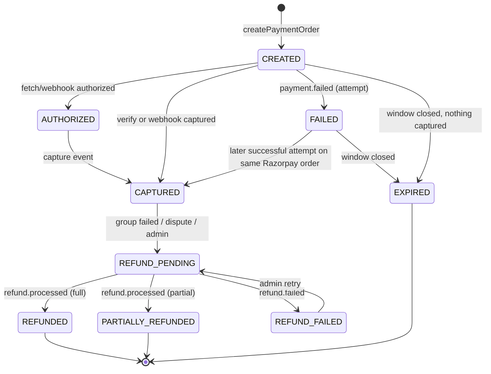
Invalid transitions (e.g. REFUNDED → CAPTURED, EXPIRED → CAPTURED without a captured event) are rejected by a transition table in code; a captured event arriving for an EXPIRED payment is treated as a **late payment**: payment CAPTURED then immediately REFUND_PENDING (auto refund), fraud signal not raised.

### 4. Idempotency and duplicates
| Duplicate | Protection |
|---|---|
| Double tap "Pay" | `createPaymentOrder` returns the existing open Razorpay order |
| Client verify + webhook both arrive | Both run the same transaction; second sees CAPTURED and no-ops |
| Webhook retried by Razorpay | `paymentEvents/{eventId}` existence check inside the transaction |
| verifyPayment retried by app | idempotency key + state check |
| Captured twice for same order (two attempts both succeed) | Second capture → auto refund + AMOUNT/DUPLICATE fraud signal for review |

### 5. Failures, cancellation, refunds
- **Failed attempt:** payment FAILED; order stays AWAITING_PAYMENT until `paymentDueAt`; user can retry.
- **Window ends unpaid:** order EXPIRED_UNPAID, member DEFAULTED, trust penalty (−40, configurable), payment EXPIRED.
- **User cancels before paying:** `cancelOrder` → CANCELLED, member DEFAULTED with smaller penalty (−15).
- **Group fails after some payments** (INSUFFICIENT_PAYMENT, NO_SUPPLIER after award, ADMIN_CANCELLED): every CAPTURED payment → REFUND_PENDING → Razorpay `POST /v1/payments/{id}/refund` (full amount, `notes.reason`) → REFUNDED on `refund.processed`.
- **Dispute resolution:** full or partial refund by admin with reason (audited).

### 6. Reconciliation (`reconcilePayments`, daily)
1. Payments CREATED/AUTHORIZED older than 1 h → fetch from Razorpay → apply missing transitions.
2. Orders PAID without a CAPTURED payment (should be impossible) → alert.
3. Razorpay captured payments of the last 48 h (list API by time range) not matched to a Firestore payment → alert + auto-refund after manual confirmation.
4. REFUND_PENDING older than 24 h → alert.
Output: summary doc in `adminActions` (system) and Cloud Logging metric; alert on any exception count > 0.

### 7. Settlement
MVP: platform account receives payments; admin records supplier settlement batches manually after delivery (`orders.settled`, `adminActions`). V1: Razorpay Route transfers on DELIVERED minus `platformFeeBps` (eligibility NOT VERIFIED, D-22).

### 8. Compliance notes
No card data touches GroupDeal servers (Razorpay-hosted checkout). Store only Razorpay IDs, method type and status. Webhook endpoint served over HTTPS by Cloud Functions. Tax invoices and GST treatment require accounting review (NOT VERIFIED).


---

# H. Security Architecture


### 1. Layers
Identity (Firebase Auth) → Client attestation (App Check) → Data access (Firestore/Storage rules) → Business authorisation (function guards) → Invariants (transactions) → Detection (fraud signals, alerts) → Accountability (audit logs).

### 2. Identity and roles
- Phone OTP (primary) and Google sign-in (D-28). SMS region policy restricted to India; Auth abuse protection (SMS fraud controls) enabled — exact console options NOT VERIFIED.
- Custom claims `{role: 'customer'|'supplier'|'admin', supplierStatus?: 'PENDING'|'VERIFIED'|'REJECTED'|'SUSPENDED'}` set only by `onUserCreated`, `supplierRegister` (→ supplier, PENDING) and admin functions. Clients force-refresh the ID token after a claim change.
- Admin bootstrap: `/scripts/grant-admin.ts` run locally with a service account against prod, once; afterwards only `adminSetRole` (requires an existing admin, audited, cannot demote the last admin).
- Admin console requires Google accounts with 2-Step Verification (organisational policy) — enforced by allow-list of admin emails in `config/admins` checked in `requireAdmin`.
- Suspended users: `users.status = SUSPENDED` checked in every guard; tokens revoked with `revokeRefreshTokens`.

### 3. Function guard library (`functions/src/guards.ts`)
`requireAuth(ctx)` · `requireAppCheck(ctx)` (enforced via options) · `requireRole(ctx, role)` · `requireVerifiedSupplier(ctx, tx)` (claim + live doc check) · `requireAdmin(ctx)` · `requireOwner(doc, uid)` · `requireActiveUser(tx, uid)` · `rateLimit(uid, key, limit, window)` (Firestore token bucket in `rateLimits/{uid}_{key}`, server-only) · `validate(schema, data)` (zod).

### 4. Security-sensitive operations (complete list)
| Operation | Risk | Controls |
|---|---|---|
| Sign-in / sign-up | fake accounts, SMS pumping | OTP, App Check, Auth fraud protection, device fingerprint signals (V1) |
| Set role / verify supplier | privilege escalation | admin-only, audited, claims not readable/writable by clients |
| Set locality | locality hopping to farm deals | server-resolved locality, 3 changes / 30 days |
| joinGroup / leaveGroup / setQuantity | count/price manipulation, churn griefing | callable-only, transaction, join-cycle limit, rate limit 30/min/user |
| createRequest | spam | 3 requests/day/user, text moderation (length, blocklist), App Check |
| voteRequest | vote stuffing | one vote doc per uid, account age ≥ 24 h to vote, VOTE_BURST signal |
| supplierProposeDeal | misleading MRP | admin approval, reference price check (D-19) |
| submitBid / withdrawBid | fake/shill bids, sniping | verified supplier, floor/ceiling, sealed, withdrawal cut-off, `consumeAppCheckToken` |
| Award auction | rigging | server-only scheduled function, deterministic ranking, audit hash |
| createPaymentOrder | amount tampering | amount from DB only |
| verifyPayment / webhook | forged success, replay | HMAC verification, server fetch, event dedupe, amount/currency check |
| Refunds | unauthorised refunds | admin or system only, reason required, audited, Razorpay idempotency via payment ID |
| Fulfilment updates | fake delivery | supplier must own the order; DELIVERED requires collection-point OTP or customer confirmation (V1) |
| Ratings | fake reviews | only after DELIVERED, one per order |
| Disputes | abuse | one per order, photo evidence, admin resolution |
| Admin config changes | business sabotage | admin-only, audited with before/after |
| File uploads | malware, oversized files | Storage rules: content-type allow-list, size limits, owner path |

### 5. Values never trusted from clients
Member counts, units, tier, any price or amount, order status, payment status, role/claims, trust score, supplier status, auction results, timestamps, locality of another user, supplier IDs on fulfilment (taken from the order).

### 6. Rules
`/firestore/firestore.rules` (in this package). Principle: public read for catalogue/live group state; owner read for private data; **no client writes** except own profile display fields, own devices, own notification `readAt`, own watchlist. Rules tests (TEST_STRATEGY §3) must cover every `allow`.

### 7. Secrets and keys
| Secret | Storage | Access |
|---|---|---|
| Razorpay key secret, webhook secret | Secret Manager per project | bound to payment functions only |
| Razorpay key ID | function returns it at checkout | public by design |
| Google Maps server key (Geocoding) | Secret Manager | `resolveLocality` only; API-restricted |
| Places SDK Android key | `local.properties` → Secrets Gradle plugin | restricted to package + SHA-256 + Places API |
| Firebase web config | public | protected by App Check + rules |
| Android upload keystore | GitHub encrypted secrets / local only | Play App Signing holds the app signing key |
| Service accounts | Workload Identity Federation for GitHub Actions | no JSON keys in CI |
Never commit `.env*`, `google-services.json` for prod (CI injects), keystores or service-account JSON. `gitleaks` runs in CI.

### 8. Abuse prevention and fraud signals
VOTE_BURST (> N votes on a request from accounts < 7 days old within 1 h) · JOIN_CHURN (≥ 3 join/leave cycles across groups in 24 h) · DEVICE_REUSE (same FCM installation across > 3 accounts — V1) · AMOUNT_MISMATCH (webhook amount ≠ order) · BID_ANOMALY (below floor attempts; winning bid < 60% of median past awards for the deal category) · DEFAULT_PATTERN (≥ 2 payment defaults in 30 days → join requires trust ≥ threshold). Signals are reviewed by admins; automated action limited to rate limiting and soft blocks.

### 9. Privacy
Data minimisation: no precise location stored; group member lists not public; activity feed anonymised; phone numbers visible only to the user and admins; suppliers see a customer's first name + collection point only for their own orders. Retention and deletion policy and DPDP Act 2023 compliance require legal review (NOT VERIFIED). Analytics events contain no PII.

### 10. Logging and audit
Structured JSON logs (`requestId`, `uid`, `fn`, `groupId`, outcome, latency) without phone numbers or payment payloads. `adminActions` for every admin and system award/refund action. Log-based alerts: webhook signature failures, reconciliation exceptions, function error rate, refund failures, admin role changes.


---

# I. UI / UX Blueprint


Design language carried over from the prototype: emerald primary (#0F9D58), dark-emerald secondary, orange accent for deal urgency; Material 3 components; rupee prices in large numerals; tier roadmap as the signature component.

### 1. Android navigation
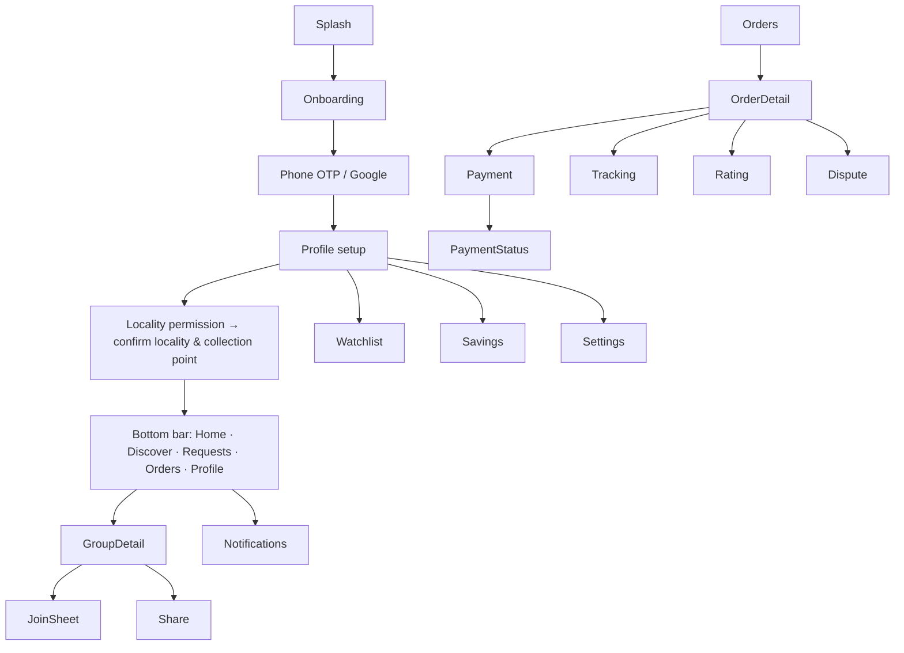
Deep links open GroupDetail/OrderDetail directly (auth gate first).

### 2. Customer screens
| Screen | Key content | States |
|---|---|---|
| Splash | logo, session check | — |
| Onboarding (3 cards) | how tiers work; pay after lock; collection-point delivery | skip |
| Login | phone input (+91), OTP (6 boxes, auto-read SMS where available), Google button | sending, invalid OTP, rate-limited |
| Locality permission | rationale ("we use approximate location only to find your locality"), Allow / Enter pincode | denied → manual |
| Home | locality chip, rails: Closing soon, Almost next tier, New; demand banner | skeleton, empty locality ("No groups yet — request one") |
| Discover | search bar, category chips, sort, GroupCard list | loading, empty search, offline cached |
| Group detail | gallery, PriceTag (current, MRP, savings %), **TierRoadmap**, ProgressMeter (n/target), "12 more for ₹799", countdown, supplier card, delivery terms, quantity, Join / Leave | pre-lock, LOCKED ("price can only go down"), BIDDING, closed, FAILED reason |
| Join sheet | quantity stepper, estimated price, rules checkbox ("I'll pay within 24 h after supplier selection") | submitting, error (CLOSED/CAPACITY/LOCALITY) |
| Requests | locality requests with VoteBar (17/20), create FAB, my requests | vote pending, already voted |
| Orders | list grouped by status; pay-now CTA with deadline | empty |
| Order detail | product snapshot, amount, saved, timeline, actions (Pay, Cancel, Rate, Dispute) | |
| Payment status | "Confirming payment…" listening to server | success, failed (retry), pending > 2 min (contact support) |
| Tracking | vertical timeline, collection point + hours, pickup code | |
| Notifications | inbox list, unread dots | empty |
| Watchlist (V1) | saved groups with countdown | |
| Profile | name, locality, trust badge (tier + score), savings summary, settings, sign out | |
| Rating | stars + text | submitted |

### 3. Supplier (web)
Onboarding wizard (business → documents → service areas) · Verification status page · Dashboard (open opportunities, active bids, orders to fulfil) · Opportunities list (locality, units, ceiling, deadline countdown) · Auction page (deal snapshot, ceiling/floor, BidForm, my revisions) · Bid history · Won auctions · Fulfilment (batch actions: confirm, dispatched, at collection point; per-order delivered) · Analytics (V1) · Profile.

### 4. Admin (web)
Dashboard (today: groups locking, auctions closing, payments pending, open disputes, reconciliation exceptions) · Users · Suppliers (verification queue with document viewer) · Localities · Deals (approval queue with schedule validator output) · Groups (state filter, extend/cancel) · Requests (threshold queue, convert wizard) · Auctions (bids table, invalidate) · Orders · Payments (reconciliation exceptions) · Disputes · Moderation · Fraud signals (V1) · Analytics · Settings (`config/app` editor with diff preview).

### 5. Reusable components
`PriceTag(unitPaise, mrpPaise, estimate: Boolean)` · `TierRoadmap(tiers, activeIndex, lockedIndex?)` · `ProgressMeter(n, target, nextThreshold)` · `CountdownChip(closesAt)` · `GroupCard` · `SupplierCard` · `VoteBar` · `StatusTimeline` · `TrustBadge` · `OfflineBanner` · `EmptyState(icon, title, action)` · `ErrorState(message, retry)` · `SkeletonCard` · `ConfirmSheet`.

### 6. Cross-cutting rules
- **Loading:** skeletons for lists; button-level spinners for actions; never block the whole screen for a mutation.
- **Empty:** explain why and offer the next action (request a product, change locality).
- **Errors:** map server reason codes to plain language (e.g. CAPACITY → "This group is full. Watch for the next round.").
- **Offline:** cached content with banner; actions disabled with tooltip.
- **Estimates vs facts:** anything not from the server is labelled "Estimated".
- **Accessibility:** content descriptions on icons, prices read as "rupees nine hundred forty-nine", 48 dp targets, contrast AA, supports font scale 200%.
- **Dark mode:** full dark scheme (prototype already defines one).
- **Localisation:** all strings in resources from day one (Tamil, Hindi in V1); numbers in Indian grouping (₹8,118).

### 7. Screenshot/diagram slots for the report
Insert device screenshots (from the production build) for: Login, Locality, Home, Discover, Group detail (pre-lock and locked), Join sheet, Requests, Payment status, Tracking, Supplier auction page, Admin approval queue.


---

# J. API / Service Contracts


All callables: region `asia-south1`, Firebase Auth required unless stated, App Check enforced, input validated with zod, errors as Firebase `HttpsError` codes. Every mutating call includes `requestId: string (UUID v4)`; the server stores the response in `idempotencyKeys/{uid}_{requestId}` and returns it for repeats (D-21). Money = integer paise.

**Client retry policy:** retry with the *same* `requestId` on `unavailable`, `deadline-exceeded`, `aborted`, `internal` (exponential backoff 1 s, 2 s, 4 s, max 3). Never retry `invalid-argument`, `permission-denied`, `failed-precondition`, `already-exists`, `resource-exhausted`.
**Logging:** every call logs `{fn, requestId, uid, outcome, errorCode?, latencyMs}`.

### Auth & profile
| Function | Request | Guards / validation | Processing | Response | Errors |
|---|---|---|---|---|---|
| `onUserCreated` (trigger) | — | — | create `users/{uid}` (trust 500 SILVER), claim customer | — | — |
| `updateProfile` | `{displayName?, photoPath?, preferences?, requestId}` | auth; name 1–60 chars | update allowed fields | `{ok}` | invalid-argument |

### Locality
| `resolveLocality` | `{lat, lng}` (not stored) | auth; rate 10/h | server Geocoding → pincode → nearest active locality | `{candidates: [{localityId, name, pincode, distanceKm}]}` | not-found (no active locality) |
| `setUserLocality` | `{localityId, collectionPointId, requestId}` | auth; locality active; ≤ 3 changes/30 days; no ACTIVE memberships in old locality pre-lock (must leave first) | update user | `{localityId}` | resource-exhausted, failed-precondition |

### Groups & pricing
| `joinGroup` | `{groupId, quantity, requestId}` | customer; PRICING_ENGINE §5 | transaction | `{memberCount, unitPricePaise, tierIndex, savingsPercent, membersToNextTier, state, version}` | failed-precondition (CLOSED, CAPACITY, LOCKED), permission-denied (LOCALITY), already-exists, resource-exhausted (JOIN_LIMIT) |
| `leaveGroup` | `{groupId, requestId}` | customer; ACTIVE member; pre-lock | transaction; recompute tier and state | same shape | failed-precondition, not-found |
| `setQuantity` | `{groupId, quantity, requestId}` | 1..max; pre-lock | transaction | `{quantity, unitsCommitted}` | invalid-argument |
| `quotePreview` | none — clients use the shared engine locally on group snapshot data; no endpoint needed | | | | |

### Requests & votes
| `createRequest` | `{productName, category, targetPricePaise, referencePricePaise, requestId}` | customer with locality; 3/day; name 3–80; target < reference | create OPEN request in user's locality, auto-vote by creator | `{requestId, voteCount: 1, threshold}` | resource-exhausted, invalid-argument |
| `voteRequest` | `{requestId_, requestId}` | same locality; account ≥ 24 h; OPEN | tx: create `votes/{uid}`, `voteCount+1`; ≥ threshold → THRESHOLD_REACHED | `{voteCount, status}` | already-exists |
| `unvoteRequest` | `{requestId_, requestId}` | voted; OPEN | tx: delete vote, −1 | `{voteCount}` | not-found |

### Watchlist & notifications
Direct Firestore writes allowed by rules (`users/{uid}/watchlist/{gid}`, `notifications/{nid}.readAt`). `registerDevice` is a direct write to `users/{uid}/devices/{installationId}`.

### Supplier
| `supplierRegister` | `{businessName, contactName, gstin?, fssaiLicenceNo?, documents[], requestId}` | auth; not already supplier | create supplier PENDING; claim role=supplier, supplierStatus=PENDING | `{status}` | already-exists |
| `supplierUpdateServiceAreas` | `{areas: [{localityId, maxDeliveryDays}], requestId}` | verified supplier; ≤ 50 | update | `{count}` | invalid-argument |
| `supplierProposeDeal` | deal fields | verified; `validateSchedule` = [] | create deal PENDING_REVIEW, anchor = caller | `{dealId}` | invalid-argument (with validation codes) |
| `submitBid` | `{groupId, unitPricePaise, deliveryDays, minUnits, requestId}` | SUPPLIER_AUCTION §4 | tx | `{revision, status}` | failed-precondition (AUCTION_CLOSED), invalid-argument (ABOVE_CEILING, BELOW_FLOOR), resource-exhausted (REVISIONS) |
| `withdrawBid` | `{groupId, requestId}` | before cut-off | tx | `{status: WITHDRAWN}` | failed-precondition |
| `supplierUpdateFulfilment` | `{groupId, status: CONFIRMED/DISPATCHED/READY_FOR_PICKUP, requestId}` or `{orderId, status: DELIVERED, pickupCode?}` | selected supplier of the group | update orders (batch ≤ 500) | `{updated}` | permission-denied |

### Orders & payments
| `createPaymentOrder` | `{orderId, requestId}` | owner; AWAITING_PAYMENT; before due | PAYMENTS §2 | `{keyId, razorpayOrderId, amountPaise, prefill}` | failed-precondition (WINDOW_CLOSED) |
| `verifyPayment` | `{orderId, razorpayOrderId, razorpayPaymentId, signature, requestId}` | owner | HMAC + fetch + tx | `{status: PAID|PENDING}` | permission-denied (SIGNATURE), failed-precondition (AMOUNT_MISMATCH) |
| `cancelOrder` | `{orderId, requestId}` | owner; AWAITING_PAYMENT | CANCELLED, member DEFAULTED (small penalty) | `{status}` | failed-precondition |
| `razorpayWebhook` (HTTPS) | raw Razorpay event | signature header | PAYMENTS §2.4 | 200 / 400 (bad signature) / 500 (retry) | — |

### Ratings & disputes
| `submitRating` | `{orderId, stars, text?, requestId}` | owner; DELIVERED; not rated | create `ratings/{orderId}`; trigger updates scores | `{ok}` | already-exists |
| `raiseDispute` | `{orderId, type, description, photoPaths[], requestId}` | owner; PAID/DELIVERED within 7 days of delivery | create dispute OPEN | `{disputeId}` | failed-precondition |

### Admin (all audited to `adminActions`, `requireAdmin`)
`adminVerifySupplier {supplierId, decision, reason?}` · `adminSetRole {uid, role}` · `adminApproveDeal {dealId, decision, reason?}` · `adminOpenGroup {dealId, localityId, opensAt?}` · `adminExtendGroup {groupId, hours ≤ 48}` (once per group) · `adminCancelGroup {groupId, reason}` · `adminConvertRequest {requestId, dealDraft}` · `adminInvalidateBid {groupId, supplierId, reason}` · `adminRefundOrder {orderId, amountPaise ≤ captured, reason}` · `adminResolveDispute {disputeId, resolution, refundPaise?}` · `adminUpsertLocality {...}` · `adminUpdateConfig {patch}` · `adminSuspendUser {uid, reason}`.

### Analytics (admin/supplier read models)
MVP: computed by scheduled function `rollupDailyStats` into `stats/daily/{yyyy-mm-dd}` (GMV, groups closed/failed by reason, average savings %, payment conversion) and `suppliers/{sid}.score`. No numbers are pre-populated.

### Shared response types (TypeScript, `functions/src/contracts.ts`, mirrored as Kotlin data classes)
```ts
type GroupStateDTO = { groupId: string; memberCount: number; unitPricePaise: number; tierIndex: number;
  savingsPercent: number; membersToNextTier: number | null; state: GroupState; version: number };
type ErrorDetail = { reason: 'CLOSED'|'CAPACITY'|'LOCKED'|'LOCALITY'|'JOIN_LIMIT'|'ABOVE_CEILING'|'BELOW_FLOOR'|
  'AUCTION_CLOSED'|'REVISIONS'|'WINDOW_CLOSED'|'SIGNATURE'|'AMOUNT_MISMATCH' };
```


---

# K. State Machines


Each machine is implemented as a transition table in `functions/src/domain/states.ts` (`assertTransition(machine, from, to)`); any transition not listed throws `failed-precondition` and is logged. Clients never set states.

### 1. Deal
| From | To | Trigger |
|---|---|---|
| DRAFT | PENDING_REVIEW | supplier submits |
| PENDING_REVIEW | ACTIVE / REJECTED | admin decision |
| ACTIVE | PAUSED / ARCHIVED | admin |
| PAUSED | ACTIVE / ARCHIVED | admin |
Open groups are unaffected by PAUSED/ARCHIVED (snapshot); no new groups open.

### 2. Group
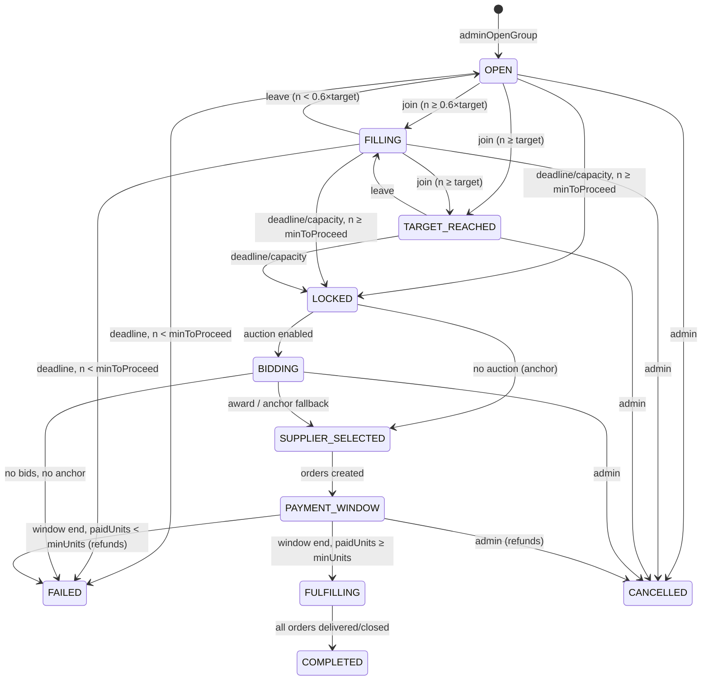
**Prototype mapping (D-24):** OPEN, FILLING, TARGET_REACHED, BIDDING, SUPPLIER_SELECTED unchanged; PAYMENT_PENDING → PAYMENT_WINDOW; PROCESSING → FULFILLING; DELIVERED → COMPLETED; EXPIRED → FAILED(MIN_NOT_REACHED); CANCELLED unchanged; new: LOCKED (transient), FAILED.

### 3. Membership (`groups/{gid}/members/{uid}`)
ACTIVE → LEFT (leave, pre-lock) · LEFT → ACTIVE (rejoin, joinCycles < 3) · ACTIVE → COMMITTED (lock) · ACTIVE → RELEASED (group FAILED before award) · COMMITTED → PAID (payment captured) · COMMITTED → DEFAULTED (window ends / order cancelled) · COMMITTED → RELEASED (group FAILED) · PAID → REFUNDED (group failed / dispute full refund).

### 4. Auction
OPEN → CLOSING (sweeper) → AWARDED | NO_VALID_BIDS · OPEN → CANCELLED (group cancelled). CLOSING exists only inside the award transaction.

### 5. Bid
ACTIVE (submit/revise; revise keeps ACTIVE, increments revision) → WITHDRAWN (before cut-off) → ACTIVE (re-bid) · ACTIVE → INVALIDATED (admin / supplier suspended) · ACTIVE → WON | LOST (award).

### 6. Request
OPEN → THRESHOLD_REACHED (votes ≥ threshold) → UNDER_REVIEW (admin opens) → CONVERTED (deal created) | REJECTED · OPEN → EXPIRED (expiresAt) · OPEN/THRESHOLD_REACHED → REJECTED (moderation). Votes allowed only in OPEN.

### 7. Order
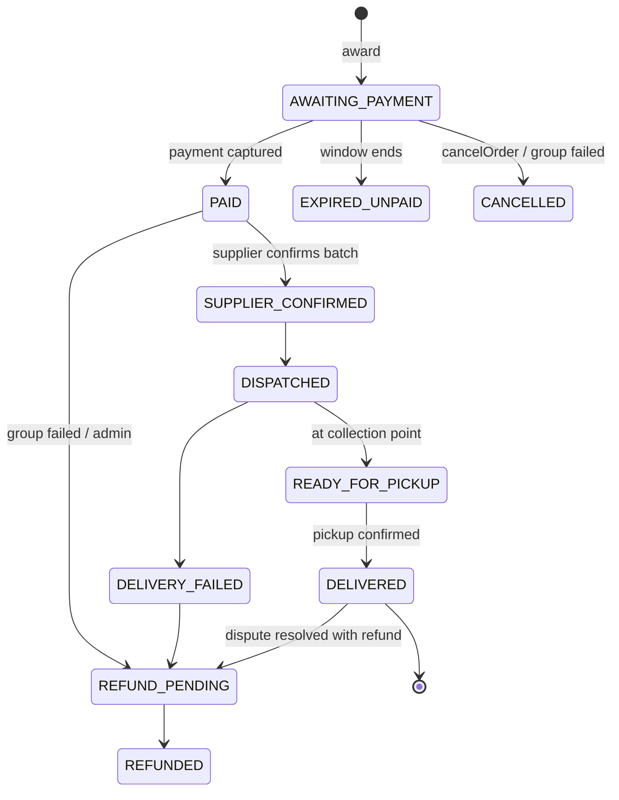
`rated` is a flag, not a state. Disputes do not change order state until resolved.

### 8. Payment
See PAYMENTS.md §3: CREATED, AUTHORIZED, CAPTURED, FAILED, EXPIRED, REFUND_PENDING, REFUNDED, PARTIALLY_REFUNDED, REFUND_FAILED.

### 9. Delivery (group-level batch, `groups/{gid}.delivery.status`)
PENDING → PACKED → DISPATCHED → AT_COLLECTION_POINT → COMPLETED · DISPATCHED → FAILED_ATTEMPT → DISPATCHED (retry once) | RETURNED. Order states are updated from the batch, except DELIVERED which is per order (pickup).

### 10. Notification (inbox doc)
QUEUED → SENT (FCM accepted) → READ (user sets `readAt`) · QUEUED → FAILED (all tokens invalid) → (no retry for broadcast; one retry after 5 min for transactional) · Inbox doc exists regardless of push outcome, so the user can always see it in-app.


---

# L. Test Strategy


No performance numbers are asserted anywhere in this document; performance targets are set only after a staging baseline is measured.

### 1. Levels and tools
| Level | Scope | Tools | Runs |
|---|---|---|---|
| Unit — pricing | `@groupdeal/pricing`, Kotlin port | node:test (implemented, 6/6 pass), JUnit | every commit |
| Unit — functions | guards, validators, state tables, ranking, signature verification | Vitest/Jest | every commit |
| Unit — Android | use cases, ViewModels, mappers | JUnit, MockK, Turbine | every commit |
| Firestore rules | every `allow`/deny path | `@firebase/rules-unit-testing` + emulator | every commit |
| Integration (backend) | callables + triggers + schedulers against emulators, Razorpay stubbed | Vitest + emulator suite | every commit |
| UI (Android) | critical screens/flows | Compose UI test, Robolectric | every PR |
| UI (web) | components | Testing Library | every PR |
| E2E | full purchase in staging with Razorpay **test mode** | Playwright (web), Maestro or UI Automator (Android) — tool choice decided at Stage 15 | nightly + pre-release |
| Concurrency | parallel joins/leaves/bids/webhooks | Node script firing N parallel callables at emulator/staging | pre-release |
| Payment | signature, webhook, duplicates, refunds, reconciliation | stubs + Razorpay test mode | every PR (stub), nightly (test mode) |
| Failure recovery | retries, partial failures, sweeper reruns | fault injection in emulator | pre-release |
| Offline/online | cache, banners, retry with same requestId | Android instrumented + network toggling | pre-release |
| Performance | cold start, feed render, function latency, hot-group contention | Macrobenchmark, Firebase Performance, load script | baseline then regression |
| Security | rules tests, App Check enforcement, secret scanning, dependency audit | rules tests, gitleaks, `npm audit`, Gradle dependency check | every PR |
| Regression | golden vectors + E2E suite | CI | every release |

### 2. Test matrix
Risk: **C** critical · **H** high · **M** medium.

| ID | Feature | Scenario | Input | Expected result | Risk |
|---|---|---|---|---|---|
| PR-01 | Pricing | Golden vectors | n = −3,0,1,4,5,14,15,18,29,30,35 | tier/price/savings/next as PRICING_ENGINE §4 | C |
| PR-02 | Pricing | Monotonic price | n = 0..60 | non-increasing | C |
| PR-03 | Pricing | Next tier never negative | n = 0..100 | null or > 0 | H |
| PR-04 | Pricing | Invalid schedules rejected | unsorted, rising price, dup threshold, base > MRP, float | specific error codes | H |
| PR-05 | Pricing | Android/TS parity | golden JSON | identical outputs | C |
| GR-01 | Join | Happy path | n=18, qty 1 | n=19, ₹949, FILLING, version+1 | C |
| GR-02 | Join | **Two users simultaneously at 14** | A,B join in parallel | n=16, both succeed, tier 2 ₹949, exactly one priceHistory doc (14→15) | C |
| GR-03 | Join | **Join while tier changing** | 50 parallel joins from n=0 | n=50 (≤ capacity), price ₹799, priceHistory 3 docs, no duplicate members | C |
| GR-04 | Join | Same user double tap | same requestId ×2 | one membership, identical responses | C |
| GR-05 | Join | Same user, different requestIds in parallel | 2 calls | one succeeds, one already-exists | C |
| GR-06 | Join | After deadline | now ≥ closesAt | failed-precondition CLOSED | H |
| GR-07 | Join | Capacity | n = capacity | failed-precondition CAPACITY; lockRequested | H |
| GR-08 | Join | Other locality | user locality ≠ group | permission-denied LOCALITY | H |
| GR-09 | Join | Join-cycle limit | 4th join | resource-exhausted | M |
| GR-10 | Leave | **Leave at tier boundary** | n=15 → leave | n=14, ₹1,099, state recomputed (FILLING/OPEN per ratio), watchers notified | C |
| GR-11 | Leave | After lock | state LOCKED/BIDDING | failed-precondition | H |
| GR-12 | Leave | Parallel leave + join at 15 | both | final n=15, tier consistent with n | C |
| GR-13 | Lock | Below minimum | n=4 at closesAt | FAILED MIN_NOT_REACHED, members RELEASED, no orders | C |
| GR-14 | Lock | Sweeper runs twice concurrently | two invocations | single transition, single auction doc | C |
| AU-01 | Auction | Valid bid | price ≤ ceiling | ACTIVE, revision 1, bidCount 1 | H |
| AU-02 | Auction | Above ceiling / below floor | | invalid-argument; below-floor creates fraud signal | H |
| AU-03 | Auction | **Competing bids simultaneously** | 10 suppliers in parallel | 10 bids, bidCount 10 | H |
| AU-04 | Auction | Revision limit | 11th revision | resource-exhausted | M |
| AU-05 | Auction | Withdraw in last 30 min | | failed-precondition | M |
| AU-06 | Auction | Tie | equal price | higher rating wins; then fewer days; then earlier priceSetAt; then supplierId | H |
| AU-07 | Auction | No bids, anchor exists | | SUPPLIER_SELECTED at ceiling | H |
| AU-08 | Auction | No bids, no anchor | | FAILED NO_SUPPLIER | H |
| AU-09 | Auction | Supplier suspended after bidding | | bid INVALIDATED at close | H |
| AU-10 | Auction | Award idempotent | sweeper rerun | one set of orders (IDs `{gid}_{uid}`) | C |
| AU-11 | Auction | Unverified supplier bids | claim PENDING | permission-denied | C |
| PA-01 | Payment | Create order amount | client sends amount | ignored; DB amount used | C |
| PA-02 | Payment | Valid verify | correct signature, captured | order PAID | C |
| PA-03 | Payment | Forged signature | wrong HMAC | permission-denied, payment unchanged | C |
| PA-04 | Payment | **Duplicate client callback** | verify ×2 | one transition, same response | C |
| PA-05 | Payment | **Webhook duplicate** | same event ×3 | processed once | C |
| PA-06 | Payment | Webhook before client verify | | PAID; later verify no-op | C |
| PA-07 | Payment | Amount mismatch in webhook | | not PAID; AMOUNT_MISMATCH signal; alert | C |
| PA-08 | Payment | Bad webhook signature | | 400, nothing written, alert metric | C |
| PA-09 | Payment | Late capture after window | | CAPTURED → auto refund | H |
| PA-10 | Payment | Insufficient paid units | paidUnits < minUnits | group FAILED, all CAPTURED refunded | C |
| PA-11 | Payment | Refund failed event | | REFUND_FAILED, alert, admin retry works | H |
| PA-12 | Payment | Reconciliation | CREATED payment captured at Razorpay, webhook lost | reconcile marks PAID | C |
| PA-13 | Payment | **Network drop after Razorpay success** | app killed before verify | webhook/reconcile marks PAID; app shows PAID on restart | C |
| RQ-01 | Requests | One vote per user | vote ×2 | already-exists | H |
| RQ-02 | Requests | Threshold | 15th vote | THRESHOLD_REACHED, admin notified | M |
| RQ-03 | Requests | Spam | 4th request in a day | resource-exhausted | M |
| RQ-04 | Requests | New-account vote | account < 24 h | failed-precondition | M |
| SE-01 | Rules | Client writes group | direct update memberCount | denied | C |
| SE-02 | Rules | Read others' membership | | denied | H |
| SE-03 | Rules | Read sealed bids of others | | denied | C |
| SE-04 | Rules | Escalate role via profile | update role field | denied | C |
| SE-05 | Rules | Read config/admins | | denied | H |
| SE-06 | App Check | Call without token (prod config) | | unauthenticated | C |
| SE-07 | Admin | Non-admin calls admin fn | | permission-denied | C |
| NO-01 | Notifications | Tier change | 14→15 | topic message + inbox for watchers | M |
| NO-02 | Notifications | Invalid token | FCM unregistered | device doc deleted | M |
| OF-01 | Offline | Open app offline | cached data | cached groups shown, banner, join disabled | M |
| OF-02 | Offline | Retry after reconnect | same requestId | no duplicate membership | C |
| OF-03 | Stale data | Out-of-order snapshot | version lower | ignored by UI | H |
| RS-01 | Restart | App killed mid-payment | | order state recovered from server | C |
| MA-01 | Malicious | Callable with extra fields (price) | | ignored/rejected by schema | C |
| MA-02 | Malicious | Script floods joinGroup | 100 calls/min | rate-limited, App Check blocks without token | H |

### 3. Rules tests
One test file per collection; each `allow` has a positive and a negative case; run in CI with the Firestore emulator. Status of the rules in this package: **written, not yet executed** (requires emulator).

### 4. Concurrency harness
`/scripts/concurrency/join-burst.ts`: creates a group at n = k, fires M parallel `joinGroup` calls (distinct users), asserts final `memberCount = k + M`, member docs = k + M, tier = `quote(n).tierIndex`, priceHistory transitions are strictly increasing and unique. Variants for leave/join interleaving and bid bursts. Run against the emulator in CI and against staging before release (emulator contention behaviour may differ from production — record differences).

### 5. Exit criteria per release
All C-risk tests pass; zero open C/H defects; rules coverage of every `allow`; E2E purchase passes in staging with Razorpay test mode; reconciliation run shows zero exceptions on staging data.


---

# M. Deployment Architecture


### 1. Environments
| Env | Firebase project | Android flavor / App ID | Web | Razorpay | Data |
|---|---|---|---|---|---|
| dev | `groupdeal-dev` + local emulators | `dev` / `in.groupdeal.app.dev` | localhost / dev backend | stub / test | synthetic |
| staging | `groupdeal-staging` | `staging` / `in.groupdeal.app.staging` | `staging.<domain>` | **test** keys | synthetic |
| prod | `groupdeal-prod` | `prod` / `in.groupdeal.app` | `<domain>` | **live** keys | real |
The package name `in.groupdeal.app` and domain are placeholders until the team registers a domain (decision needed — see LAPTOP START).

### 2. CI/CD (GitHub Actions)
| Workflow | Trigger | Steps |
|---|---|---|
| `pricing.yml` | PR touching `packages/pricing` | test, publish vectors artifact |
| `functions.yml` | PR | lint, typecheck, unit, emulator integration, rules tests |
| `android.yml` | PR | ktlint/detekt, unit, golden parity, lint, assembleDevDebug |
| `web.yml` | PR | lint, typecheck, unit, build |
| `security.yml` | PR + weekly | gitleaks, npm audit, Gradle dependency check |
| `deploy-staging.yml` | merge to `main` | deploy firestore rules/indexes, functions, web to staging; build staging AAB → Play internal track |
| `deploy-prod.yml` | tag `v*` + manual approval (GitHub Environment `production`) | same to prod; AAB → Play closed/production track |
Auth to Google Cloud from Actions via **Workload Identity Federation** (no JSON keys). Deploy order: rules/indexes → functions → web → Android rollout.

### 3. Secrets
Secret Manager per project (Razorpay key secret, webhook secret, Maps server key). GitHub Environment secrets: upload keystore (base64) + passwords, Play service account via WIF, `google-services.json` per flavor. Rotation: Razorpay secrets rotated on any suspected exposure and at least yearly.

### 4. Android release
Play App Signing (Google holds the app signing key; team keeps the upload key). Versioning: `versionCode` from CI run number, `versionName` from tag. Staged rollout 10% → 50% → 100% with Crashlytics crash-free gate (threshold set after baseline). Data safety form completed from SECURITY.md §9.

### 5. Web release
Firebase App Hosting backends per environment connected to the repo; HTTPS certificates managed by Firebase; custom domain via DNS verification. Rollback = redeploy the previous build from the App Hosting rollout history.

### 6. Functions and Firestore release
Backward-compatible changes only: new fields optional; clients tolerate unknown fields; callables versioned by adding new names (`joinGroupV2`) when contracts break; old ones removed after the minimum supported app version moves. Index deployments before code that needs them.

### 7. Data migration strategy
Migrations are idempotent scripts in `/scripts/migrations/NNNN_name.ts`, run first on staging, recorded in `config/migrations`. Pattern: expand (add field, dual-write) → backfill (batched, resumable) → contract (remove old field) across two releases.

### 8. Observability
Crashlytics (Android), Firebase Performance, Google Analytics for Firebase (no PII), Cloud Logging structured logs, Error Reporting, log-based metrics + Cloud Monitoring alerts: function error rate, webhook signature failures, reconciliation exceptions, refund failures, payment verification failures, sweeper lag (oldest due group age), budget alerts on the billing account. On-call: the two maintainers; alert channel email + phone push.

### 9. Backups and disaster recovery
Firestore **point-in-time recovery** (7-day window) and **scheduled backups** (daily, 14-day retention) in prod — availability and cost to confirm in console (NOT VERIFIED). Storage bucket object versioning for supplier documents. DR runbook: restore backup to a new database, point functions at it via config, verify reconciliation against Razorpay, then switch clients. Recovery objectives to be set after a restore drill in staging.

### 10. Release process
1. Feature flags off by default. 2. Merge → staging auto-deploy. 3. Run E2E + concurrency + reconciliation on staging. 4. Tag → prod approval. 5. Staged Android rollout. 6. Post-release checks (dashboard, error rates, payment success path). 7. Rollback plan per component (functions redeploy previous tag, web rollback, Play halt rollout).


---

# N. New Feature Plan


Evaluation rule: a feature ships only if it (a) increases the probability that a group reaches a better tier, (b) increases trust/safety, or (c) reduces operational cost. Complexity: S (≤ 3 days), M (≤ 2 weeks), L (> 2 weeks) for the two-person team.

| Feature | User value | Technical design | Data | Backend | Security | Cx | Release |
|---|---|---|---|---|---|---|---|
| **Tier-reach notifications** | Members learn the price dropped; watchers learn a deal is near a tier | `onPriceHistoryCreated` → topic `group_<gid>`; "1 more for ₹X" when `membersToNextTier ≤ 2` (debounced 30 min) | priceHistory, watchers | trigger, FCM | no PII in payload | S | **MVP** |
| **Deal countdown** | Urgency, clarity on lock time | `CountdownChip(closesAt)`; "closes around" wording (D-16) | closesAt | none | none | S | **MVP** |
| **Group momentum indicator** | Shows if the group is likely to reach the next tier | joins in last 24 h from `activity` count, shown as "+6 today" (no prediction) | activity | aggregate field `joins24h` updated hourly | anonymised | S | **MVP** |
| **Shareable deal links** | Members recruit neighbours → more tiers reached (core growth loop) | `/g/{gid}` SSR page + Android App Links; share sheet with "12 more for ₹799" | group | web SSR read | public data only; no member info | S | **MVP** |
| **Deal activity timeline** | Transparency ("tier unlocked at 15") | list from `activity` + `priceHistory` | existing | none | anonymised | S | **MVP** |
| **Savings dashboard** | Shows value delivered → retention | sum of `savedPaise` over PAID/DELIVERED orders, monthly rollup in user doc | orders | trigger on order DELIVERED | own data only | S | V1 |
| **Favorites / Watchlist** | Get reminded before close | `users/{uid}/watchlist`; "closing in 3 h" sweeper notification | watchlist | sweeper | rules: self only | S | V1 |
| **Supplier reputation** | Trust when choosing deals; auction tiebreak | ratings → `suppliers.score` (avg ×100, count, on-time %) | ratings, orders | trigger | ratings only after delivery | M | **MVP** (needed for tiebreak) |
| **Dispute support** | Recourse for damaged/missing goods | disputes collection + admin workflow + refunds | disputes, photos | callables, admin | evidence, one per order | M | **MVP** |
| **Price history** | Proof that group buying beats MRP over time | per-deal series of `finalUnitPricePaise` per completed group | groups | rollup | public | S | V1 |
| **Estimated time-to-next-tier** | Helps decide to wait vs share | simple rate = joins in last 24 h; "at the current pace, about X h" only if ≥ 3 joins/24 h, otherwise hidden; labelled estimate | activity | hourly aggregate | none | S | V1 |
| **Personalised locality feed** | Relevant deals first | rank by category affinity (past orders/votes) then closing time; rule-based | orders, votes | callable `getFeedRanking` or client-side sort | own data | M | V1 |
| **Smart reorder** | Repeat staples quickly | "notify me when this deal reopens" → subscription doc; triggered when a group opens for the same deal in the locality | subscriptions | trigger on group create | self only | S | V1 |
| **Supplier analytics** | Suppliers price better | win rate, avg award vs ceiling, ratings | auctions, orders | rollups | supplier sees own only | M | V1 |
| **Admin analytics** | Operate the marketplace | daily rollups (GMV, fail reasons, conversion) | all | `rollupDailyStats` | admin only | M | V1 |
| **Suspicious activity detection** | Protects fairness | rule-based signals (SECURITY §8) | votes, joins, payments | triggers | admin review | M | MVP (rules) / V1 (dashboard) |
| **Tamil/Hindi localisation** | Reach beyond English users | string resources, locale switch | — | notification templates per language | — | M | V1 |
| **Referral rewards** | Growth | credits on referee's first delivered order | referrals | callable + trigger | abuse risk (self-referral) → device/phone checks | M | FUTURE |
| **Smart deal recommendations (ML)** | Discovery | needs data volume first; start rule-based | orders | — | — | L | FUTURE |
| **Demand forecasting (ML)** | Suppliers plan supply | needs ≥ several months of history | requests, orders | offline model | aggregated only | L | FUTURE |
| **Locality demand heatmap** | Admin/supplier planning | aggregate open requests + joins per locality on a map (admin web) | aggregates | rollup | aggregated, no individuals | M | FUTURE |
| **Delivery tracking integration** | Live courier tracking | courier API adapter | shipments | webhooks | — | L | FUTURE |

**Rejected for now:** in-app chat between members (moderation burden, privacy), dynamic ML pricing (contradicts transparent tier rule), cash on delivery (breaks pay-after-lock guarantees for suppliers).


---

# O. Academic Report-Ready Technical Structure


The submitted PBL report (102-page build, September 2026) documents the **prototype** and the **proposed** system. When the production build exists, update the report using the labels below. Never report results that were not measured.

Labels: **IMPLEMENTED** (in prototype source today) · **DESIGNED** (fully specified in this blueprint, not coded) · **PROPOSED** (direction agreed, details open) · **FUTURE**.

| Report section | Material | Status today | Source doc |
|---|---|---|---|
| Introduction / problem | Fragmented household demand; bulk prices inaccessible; no price–demand visibility | — | PRODUCT_REQUIREMENTS |
| Objectives | FR-01..20 condensed to 8 objectives | — | PRODUCT_REQUIREMENTS §5 |
| Literature themes | group-buying price discovery; quantity discounts; dynamic pricing (contrast: rule-based vs optimisation); reverse auctions; social commerce; trust/reputation; mobile architecture | refs already verified in report ch. 13 | — |
| Existing system | individual retail, e-commerce per-order pricing, informal chat pooling | — | report ch. 3 |
| Proposed system | deal vs group model; pay-after-lock; sealed reverse auction; anchor supplier | DESIGNED | DECISIONS D-04..D-09 |
| Methodology | iterative PBL; prototype → audit → blueprint → staged build | IMPLEMENTED (process) | ROADMAP |
| Architecture | Android MVVM/Clean + Firebase serverless + web portal; trust boundaries | DESIGNED | SYSTEM_ARCHITECTURE |
| Database design | Firestore schema with reasoning | DESIGNED | DATABASE_SCHEMA |
| Algorithms | tier pricing (integer paise), membership transaction, auction ranking, payment verification | pricing engine **IMPLEMENTED in TypeScript and tested** (6/6); others DESIGNED | PRICING_ENGINE, SUPPLIER_AUCTION, PAYMENTS |
| Implementation | prototype modules (IMPLEMENTED); production modules per stage | mixed | PROJECT_AUDIT, ROADMAP |
| Testing methodology | matrix with risk levels; concurrency harness; rules tests | DESIGNED | TEST_STRATEGY |
| Results | Only measured facts: golden-vector results; later E2E/concurrency results from staging runs with dates | partial | — |
| Applications, advantages | from report ch. 10–11 | — | — |
| Limitations | hot-document limits, non-payment risk, supplier liquidity, locality density, external dependencies | — | RISKS |
| Future scope | FEATURE_PLAN FUTURE rows; iOS; courier integration; ML (clearly future) | FUTURE | FEATURE_PLAN |

**References to verify before citing:** Firebase docs pages for transactions, App Check, App Hosting, PITR/backups; Razorpay docs for orders API, signature verification and webhooks; Google Places SDK docs; Firestore write-rate guidance (AS-3). Cite URLs with access dates.

**Screenshot / diagram insertion points:** Fig. architecture (SYSTEM_ARCHITECTURE §1), purchase lifecycle (§5.4), join sequence (§5.2), payment sequence (§5.6), group state machine (STATE_MACHINES §2), payment state machine (PAYMENTS §3), ER-style schema (DATABASE_SCHEMA), device screenshots listed in UI_UX §7.


---

# P. Exact Implementation Roadmap


Each stage ends with its acceptance criteria green in CI. Stages 0–10 + 14–16 form the **MVP**; 11–13 complete V1 features. "Tests" lists the minimum; TEST_STRATEGY IDs referenced.

| Stage | Objective | Files / modules | Dependencies | DB changes | Backend | UI | Tests | Acceptance criteria |
|---|---|---|---|---|---|---|---|---|
| **0 Foundation** | Monorepo, toolchains, Firebase projects, CI skeleton | `/android` (Gradle version catalog, modules from ANDROID §2), `/functions` (TS, zod, firebase-functions v2), `/web` (Next.js+Tailwind), `/packages/pricing` (from this package), `/firestore`, `/scripts/seed.ts`, `.github/workflows/*`, `ENGINEERING_GUIDELINES.md` | Firebase CLI, Node 20, JDK 17, Android Studio | rules + indexes from this package | emulator config, `guards.ts`, `contracts.ts`, `states.ts` skeleton | app shell with theme | pricing tests (PR-01..04) in CI | `firebase emulators:start` works; CI green on empty modules; pricing tests pass in CI |
| **1 Design system** | Reusable UI kit | `:core:designsystem`, `:core:ui`, `web/components/ui` | 0 | — | — | PriceTag, TierRoadmap, ProgressMeter, CountdownChip, GroupCard, Empty/Error/Offline | screenshot/UI tests of components | Components render in light/dark, font scale 200%, TalkBack labels |
| **2 Authentication** | Phone OTP + Google; roles | `:feature:auth`, `functions/src/auth/*`, `web/app/login`, session route | 0,1 | `users` | `onUserCreated`, claims, `updateProfile` | login, OTP, profile setup | SE-04, SE-07, auth integration | New user gets `users/{uid}` + claim customer; admin bootstrap script works on dev |
| **3 Locality** | Resolve and set locality | `:feature:locality`, `functions/src/locality/*`, `scripts/seed-localities.ts` | 2 | `localities`, user locality fields | `resolveLocality`, `setUserLocality` | permission rationale, picker | change-limit test, invalid pincode test | User can only pick active localities; ≤ 3 changes/30 days; no precise location stored |
| **4 Deal discovery** | Deals + groups visible per locality | `:feature:home`, `:feature:discover`, `functions/src/catalogue/*`, `web/admin/deals`, `web/supplier/onboarding` (minimal) | 3 | `deals`, `groups` | `supplierProposeDeal`, `adminApproveDeal`, `adminOpenGroup` (validateSchedule enforced) | home rails, feed, search, filters, group detail (read-only) | PR-04 via API, rules SE-01 | Admin opens a group; customers in that locality see it live; other localities don't |
| **5 Groups** | Transactional join/leave/quantity | `:feature:group`, `functions/src/groups/{join,leave,setQuantity}.ts` | 4 | `members`, `priceHistory`, `activity`, `idempotencyKeys` | callables per PRICING_ENGINE §5 | join sheet, leave, live progress | GR-01..12 incl. concurrency harness | Parallel join tests pass; counts exact; no client can write group docs |
| **6 Dynamic pricing lifecycle** | Lock, fail-below-minimum, state machine | `functions/src/groups/sweepGroups.ts`, `states.ts` | 5 | lock fields | `sweepGroups` | locked/failed states on detail | GR-13, GR-14 | Groups lock within one sweep of `closesAt`; double sweeps safe |
| **7 Supplier bidding** | Sealed reverse auction | `functions/src/auction/*`, `web/app/(supplier)/*` | 6, supplier verification (part of 12 pulled forward: `adminVerifySupplier`) | `suppliers`, `auctions`, `bids`, `revisions` | `supplierRegister`, `supplierUpdateServiceAreas`, `submitBid`, `withdrawBid`, `sweepAuctions`, `createOrdersForGroup` | supplier opportunities, auction page, bid form | AU-01..11 | Award deterministic and idempotent; orders created once per member |
| **8 Orders** | Order lifecycle & fulfilment | `:feature:orders`, `functions/src/orders/*`, `web/supplier/fulfilment` | 7 | `orders` | `cancelOrder`, `supplierUpdateFulfilment`, `onOrderStatusChanged` | orders list/detail/timeline | order transition table tests | Every order transition validated; supplier can only update own groups |
| **9 Payments** | Razorpay end-to-end | `:feature:orders/payment`, `functions/src/payments/*` | 8, Razorpay test account (AS-1) | `payments`, `paymentEvents` | `createPaymentOrder`, `verifyPayment`, `razorpayWebhook`, `sweepPaymentWindows`, `reconcilePayments`, refunds | checkout, payment status | PA-01..13 | Test-mode purchase + refund pass; duplicates/forgeries rejected; reconciliation clean |
| **10 Notifications** | Push + inbox | `:feature:notifications`, `functions/src/notify/*` | 5,8,9 | `devices`, `notifications` | triggers, FCM topics/tokens | inbox, deep links | NO-01, NO-02 | Tier change, award, payment, dispatch notifications delivered on device; inbox complete |
| **11 Ratings/trust** | Ratings, supplier score, customer trust | `functions/src/trust/*` | 8 | `ratings`, score fields | `submitRating`, `onRatingCreated`, trust recompute | rating screen, trust badge | rating-once test, score math tests | Scores update; tiebreak uses score |
| **12 Admin** | Full console | `web/app/(admin)/*`, `functions/src/admin/*` | 2–11 | `adminActions`, `disputes`, `fraudSignals`, `config` | all admin callables, `raiseDispute`, signals | admin screens per UI_UX §4 | SE-07, audit tests | Every admin action audited with reason; disputes resolvable with refunds |
| **13 Advanced features** | MVP items from FEATURE_PLAN (share links, momentum, countdown) then V1 list | per FEATURE_PLAN | 10–12 | per feature | per feature | per feature | per feature | Feature flags controlled; each feature has tests |
| **14 Security hardening** | Enforce App Check, rate limits, fraud rules | `guards.ts`, rules, App Check config | all | `rateLimits`, `fraudSignals` | `consumeAppCheckToken` on money/bid fns | — | SE-01..07, MA-01..02 | Pen-test checklist passes; no client-writable business fields |
| **15 Testing** | Complete matrix, E2E, load | `/scripts/concurrency`, E2E suites | all | — | — | — | full TEST_STRATEGY matrix | Exit criteria TEST_STRATEGY §5 met |
| **16 Deployment** | Staging → prod | workflows, Play Console, App Hosting, monitoring | 15 | backups/PITR | alerts | store listing | release dry run | PRODUCTION_CHECKLIST complete; staged rollout started |


---

# Q. Production Readiness Checklist


### Product & legal
- [ ] Terms of use, privacy policy, refund & cancellation policy published (legal review — NOT VERIFIED)
- [ ] DPDP Act 2023 obligations reviewed; data deletion flow working
- [ ] Supplier agreement (anchor obligation, delivery terms, settlement) signed
- [ ] FSSAI/GST requirements for food deals confirmed with an accountant

### Security
- [ ] App Check enforced on Functions, Firestore, Storage (staging and prod)
- [ ] Rules tests cover every allow path; all pass
- [ ] No secrets in repo (gitleaks clean); Secret Manager bindings least-privilege
- [ ] Admin allow-list set; first admin bootstrapped; script access revoked
- [ ] Maps/Places keys restricted (package + SHA-256 / API restrictions)
- [ ] Razorpay webhook secret configured; signature failures alert
- [ ] Rate limits configured; fraud signal triggers deployed

### Correctness
- [ ] Golden vectors pass on TS and Android
- [ ] Concurrency harness passes on staging (joins, leaves, bids, webhooks)
- [ ] Full purchase E2E in Razorpay test mode passes, including refund
- [ ] Reconciliation job: zero exceptions on staging for 7 consecutive days
- [ ] Sweeper idempotency verified (double invocation test)

### Operations
- [ ] Monitoring dashboards + alerts live; on-call contacts set
- [ ] Budget alerts on billing account
- [ ] PITR + scheduled backups enabled; restore drill done in staging
- [ ] Runbooks: payment incident, webhook outage, stuck sweeper, data restore, compromised admin
- [ ] Play App Signing enrolled; upload key stored safely; staged rollout plan

### UX & quality
- [ ] Loading/empty/error/offline states on every screen
- [ ] Accessibility pass (TalkBack, font scale 200%, contrast)
- [ ] Crash-free rate gate defined from baseline
- [ ] Localisation framework in place (English shipped)


---

# R. Top Architectural Risks and Mitigations


| # | Risk | Likelihood / impact | Mitigation | Owner stage |
|---|---|---|---|---|
| 1 | Hot group document contention during viral deals (AS-3) | Medium / High | Transactions + client retries; load test; Cloud Tasks join queue fallback; capacity caps | 5, 15 |
| 2 | Non-payment after lock makes supplier economics fail | High / High | `minUnits` in bids, payment window reminders, trust penalties, join gating for repeat defaulters, anchor obligation priced with expected default rate | 7, 9, 11 |
| 3 | Not enough verified suppliers per locality → auctions empty | High / High | Anchor-supplier deals as the default; auctions optional per deal; start in 1–2 localities | 4, 7 |
| 4 | Locality density too low to reach tiers | High / Medium | Tiers designed per locality size; share links; request-driven deals only; widen locality to pincode clusters (FUTURE) | 3, 13 |
| 5 | Payment edge cases (lost webhooks, duplicate capture, late payment) | Medium / Critical | Server verification + webhook + reconciliation + auto refunds; alerts | 9 |
| 6 | Client manipulation of price/state | Medium / Critical | No client writes; App Check; rules tests | 5, 14 |
| 7 | Fake accounts inflating groups or votes | Medium / High | Phone OTP, account-age gate for votes, join-cycle limits, fraud signals | 2, 14 |
| 8 | Supplier fraud (fake bids, non-delivery) | Medium / High | Document verification, floor price, sealed bids, collection-point pickup confirmation, suspension | 7, 12 |
| 9 | Scheduler delays at deadlines | Low / Medium | 5-minute sweeps, "closes around" wording, transactions re-check deadlines, lag alert | 6, 16 |
| 10 | Cost overrun (reads from listeners, SMS OTP) | Medium / Medium | Paged queries, listener scoping by locality, budget alerts, SMS region policy | 4, 16 |
| 11 | Scope creep vs two-person team | High / High | MVP fixed to Stages 0–10 + 14–16; feature flags; V1 list frozen | all |
| 12 | Legal/compliance gaps (DPDP, food safety, tax) | Medium / High | Legal/accounting review before live payments; restrict MVP categories | 16 |
| 13 | Platform parity drift in pricing | Low / High | Single TS source + golden vectors enforced in Android CI | 0 |
| 14 | Vendor dependency (Firebase, Razorpay) | Low / Medium | Gateway interface in functions; data export scripts | 9, 16 |


---

# S. Laptop Execution Starting Point


Goal of the first sessions: **prove the core of GroupDeal end to end on emulators** — two users join the same group concurrently, the server computes the tier price in a transaction, and the Android app shows the new price live. Everything else builds on this.

### Step 0 — decisions to make before writing code (one sitting)
1. Android application ID (placeholder `in.groupdeal.app`) and whether a domain will be registered.
2. Firebase project IDs (`groupdeal-dev`, `groupdeal-staging`, `groupdeal-prod` or similar). Emulators need no billing; staging/prod need the Blaze plan (AS-2).
3. GitHub repository URL (also needed for the report's Appendix A.11).
Record the answers in `DECISIONS.md` (new D-entries).

### Step 1 — repository and tooling (Stage 0)
```bash
# tools: Node 20 LTS (+ Node 22 optional for --experimental-strip-types), JDK 17, Android Studio, Git
npm i -g firebase-tools
mkdir groupdeal && cd groupdeal && git init
# copy from this package: docs/, ENGINEERING_GUIDELINES.md, packages/pricing/, firestore/
firebase login
firebase init firestore functions emulators   # TypeScript functions; Firestore, Auth, Functions, Storage emulators
```
Point `firebase.json` at `firestore/firestore.rules` and `firestore/firestore.indexes.json`.

### Step 2 — pricing package first (already written)
Run `node --experimental-strip-types --test packages/pricing/test/engine.test.ts` (Node 22), or add Vitest and run it under Node 20. Expect 6 passing tests. Wire it into `functions` as a workspace dependency.

### Step 3 — backend core (Stage 5 pulled forward)
In this order, each with tests on the emulator:
1. `functions/src/guards.ts` (requireAuth, requireRole, validate, rateLimit stub) and `contracts.ts`.
2. `functions/src/domain/states.ts` with the group and membership transition tables.
3. `functions/src/groups/join.ts` and `leave.ts` exactly as PRICING_ENGINE.md §5 (transaction + idempotency key + priceHistory + activity).
4. `scripts/seed.ts`: one locality (`IN-560034`), one approved ghee deal, one OPEN group with `memberCount = 14`, 40 test users in that locality.
5. Rules tests for `groups` and `members` (SE-01, SE-02).
6. `scripts/concurrency/join-burst.ts`: GR-02 (two users at 14 → 16, exactly one priceHistory doc) and GR-03 (50 parallel joins).

### Step 4 — Android thin slice (Stages 0–1, 5)
1. Create the module structure from ANDROID_ARCHITECTURE.md §2 (start with `:app`, `:core:model`, `:core:domain`, `:core:data`, `:core:designsystem`, `:feature:group`).
2. Port `engine.ts` to `core/domain/pricing/PricingEngine.kt` (Long paise) and add a JUnit test that reads `golden-vectors.json`.
3. Connect to the emulators (dev flavor), sign in with the Auth emulator's phone flow.
4. Build `GroupDetailScreen` (TierRoadmap, PriceTag, ProgressMeter) observing `groups/{gid}` and a Join button calling `joinGroup` through `FunctionsClient` with a `requestId`.

### Definition of done for the first milestone
- [ ] Pricing tests pass in CI (TS) and on Android (golden vectors).
- [ ] GR-02 and GR-03 pass on the emulator; member counts exact; one priceHistory doc per tier crossing.
- [ ] Rules tests deny direct client writes to groups and members.
- [ ] On a device/emulator, two signed-in test users join at 14; both screens show **16 members, ₹949, 14 more for ₹799** within the listener update, with no manual refresh.

Then continue with Stage 2 (real authentication) and follow IMPLEMENTATION_ROADMAP.md in order.


---

# Appendix 1. Decisions and Architectural Decision Records


This file is the tie-breaker. If any document contradicts this file, this file wins and the other document is a bug.

### 1. Engineering decisions (D-xx)

| ID | Decision |
|---|---|
| D-01 | Monorepo: `/android`, `/web`, `/functions`, `/packages/pricing`, `/firestore` (rules, indexes, tests), `/docs`, `/scripts`, `ENGINEERING_GUIDELINES.md`. |
| D-02 | All Firebase resources in **asia-south1 (Mumbai)**. |
| D-03 | **Money is integer paise** everywhere (₹949 = `94900`). No floating-point money in storage, APIs or logic. Savings % = `floor((mrp − price) × 100 / mrp)`. |
| D-04 | **Deal** = offer template (product, MRP, tier schedule, rules). **Group** = one buying round of a deal in one locality with a deadline. Prices, members and auctions belong to groups. |
| D-05 | Tier thresholds count **active members**, not units. Each member buys 1..`maxQtyPerMember` units (default 3) at the group unit price. `unitsCommitted` is tracked for suppliers. |
| D-06 | **Pay after lock.** No money moves while a group is open. Members pay the final price after the auction. |
| D-07 | A group **locks** at `closesAt` or when `capacity` is reached. At lock, if `memberCount < minMembersToProceed` (default = first tier threshold) the group FAILS and nobody is charged. |
| D-08 | At lock the current tier price becomes the **ceiling**. Sealed-bid, first-price **reverse auction**; lowest valid bid wins; `finalUnitPrice = winningBid ≤ ceiling`. The deal's **anchor supplier** (if any) is obliged to deliver at the ceiling when no valid bid arrives. |
| D-09 | Members who don't pay in the window **default**; the price is **not** re-raised for others. The winning bid carries `minUnits`; if paid units < `minUnits` the group FAILS and paid members are refunded in full. |
| D-10 | **Clients never write business collections.** Every mutation is a callable Cloud Function using the Admin SDK inside a transaction. Rules allow reads and a few self-owned writes only. |
| D-11 | **Android = customer app.** **Web (Next.js) = supplier portal + admin console + public share pages.** No customer checkout on web in V1. |
| D-12 | Android talks to the backend through Firebase SDKs and **callable functions**; **Retrofit is not used in MVP**. OkHttp is present transitively (Coil). Retrofit is reserved for any future non-Firebase REST API. |
| D-13 | Offline: **Firestore offline persistence is the primary cache.** Room stores device-local data only (recent searches, request drafts, last-known orders snapshot, pending-read markers). |
| D-14 | Locality ID = `IN-<pincode>` (e.g. `IN-560034`) from a curated registry. GPS is reverse-geocoded **server-side**; only `localityId` and a 5-character geohash are stored. |
| D-15 | Roles are Firebase **custom claims** `{role, supplierStatus}` set only by admin functions. The first admin is bootstrapped with a one-off script. |
| D-16 | Deadlines are processed by an idempotent **scheduled sweeper every 5 minutes**. Displayed deadlines say "closes around HH:MM". |
| D-17 | Notifications: per-user FCM tokens for transactional messages; topic `group_<gid>` for broadcast price/tier changes; every user-visible notification also gets an inbox document. |
| D-18 | Web hosting: **Firebase App Hosting** (alternative: Vercel). |
| D-19 | Price comparison through server-side adapters. MVP sources: supplier-declared MRP + admin-verified reference price. Marketplace/affiliate adapters are FUTURE and their availability is **NOT VERIFIED**. |
| D-20 | A user may join/leave a group at most 3 times (anti-griefing). Leaving is allowed only before lock. |
| D-21 | Every mutating callable takes a client-generated `requestId` (UUID v4) for **idempotency**. |
| D-22 | Supplier settlement: MVP = manual settlement recorded by admin. V1 = Razorpay Route split settlement (account eligibility **NOT VERIFIED**). |
| D-23 | Savings shown with floor rounding (30+ ghee tier = **42%**, not the prototype's 43%). Never overstate savings. |
| D-24 | Production group states replace the prototype enum (mapping in STATE_MACHINES.md §2). `FILLING` = `memberCount ≥ 0.6 × targetMembers`, recomputed on **join and leave** (fixes D1). |
| D-25 | The prototype is rebuilt, not refactored. Reused: pricing rule, domain vocabulary, screen designs. |
| D-26 | Delivery = batch to a locality **collection point**; supplier updates tracking in the portal. Courier integration is FUTURE. |
| D-27 | Cloud Functions in **TypeScript, Node.js 20, 2nd gen**. Shared pricing package `@groupdeal/pricing` is the single source of the pricing rule; Android ports it and must pass the same `golden-vectors.json`. |
| D-28 | Phone OTP is the primary sign-in (India); Google sign-in secondary. Email/password not offered. |

### 2. Assumptions (verify before launch)

| ID | Assumption | Verify by |
|---|---|---|
| AS-1 | Razorpay test + live accounts are obtainable by the team/institution | Razorpay onboarding |
| AS-2 | Firebase Blaze plan is available (required for Functions, Scheduler, outbound calls) | Billing setup |
| AS-3 | Firestore single-document sustained write guidance (approx. 1 write/s per document) applies to hot groups | Firestore docs + load test |
| AS-4 | Google Places / Geocoding quotas suffice for locality resolution | Maps Platform console |
| AS-5 | FCM delivery is best-effort; no delivery receipts are relied upon | FCM docs |
| AS-6 | Collection points can be organised per locality (RWA/shop partner) | Operations |

### 3. Architectural Decision Records

#### ADR-01 Firebase as the backend platform
- **Context:** Two students, real-time shared state, auth, push, payments glue, limited ops capacity.
- **Decision:** Firebase (Auth, Firestore, Functions, Storage, FCM, App Check, Hosting).
- **Alternatives:** Node/Express + MongoDB (zeroth-review plan); Supabase; Spring Boot + Postgres.
- **Reasoning:** Real-time listeners, managed auth with phone OTP, serverless scaling, first-class Android SDKs, local emulator suite for testing.
- **Trade-offs:** Vendor lock-in; query limitations; per-operation billing; hot-document write limits.
- **Consequences:** Data model designed for Firestore access patterns; aggregates kept on group docs; hot groups need load testing (AS-3).

#### ADR-02 Cloud Firestore over Realtime Database
- **Context:** Structured documents, compound queries by locality/state/deadline, transactions.
- **Decision:** Firestore (Native mode).
- **Alternatives:** Realtime Database; Cloud SQL.
- **Reasoning:** Richer queries and indexes, transactions, better security-rule model, offline persistence.
- **Trade-offs:** No joins; write limits per document; index management.
- **Consequences:** Denormalised read models (ADR-12); composite indexes in `firestore.indexes.json`.

#### ADR-03 Cloud Functions for all business mutations
- **Context:** Pricing, membership, auctions and payments must be tamper-proof.
- **Decision:** Callable functions (2nd gen, TypeScript) own every business write; scheduled + Firestore-triggered functions handle deadlines and side effects.
- **Alternatives:** Client writes guarded by rules only; separate API server.
- **Reasoning:** Rules cannot express multi-document invariants (price from count) or call Razorpay; one backend for Android and web.
- **Trade-offs:** Cold starts; slightly higher latency than direct writes.
- **Consequences:** Clients are thin; `minInstances` set for `joinGroup` and payment functions in production.

#### ADR-04 Kotlin + Jetpack Compose for Android
- **Context:** Prototype already in Kotlin/Compose; course is Android-focused.
- **Decision:** Kotlin, Compose, Material 3.
- **Alternatives:** Flutter (zeroth-review plan), React Native, XML views.
- **Reasoning:** Native performance, team experience from the prototype, official Android direction.
- **Trade-offs:** No iOS from the same codebase.
- **Consequences:** iOS is FUTURE; the web portal covers non-Android roles.

#### ADR-05 MVVM + Clean Architecture with Hilt
- **Context:** Prototype's singleton made screens untestable.
- **Decision:** UI (Compose) → ViewModel (`StateFlow<UiState>`) → UseCases → Repositories (interfaces) → data sources; Hilt DI; feature modules.
- **Alternatives:** MVI framework; single-module MVVM.
- **Reasoning:** Testable with MockK; matches Android architecture guidance; incremental adoption.
- **Trade-offs:** More boilerplate.
- **Consequences:** Every screen has a ViewModel and a `UiState` sealed model.

#### ADR-06 Server-side pricing
- **Context:** Prices determine money owed.
- **Decision:** Only the server computes and stores `currentUnitPrice`, `lockedUnitPrice`, `finalUnitPrice`, order amounts.
- **Alternatives:** Client computes, server validates.
- **Reasoning:** A modified client must never influence price.
- **Trade-offs:** Display depends on the network (mitigated by listeners and cache).
- **Consequences:** Clients may compute *previews* with the shared engine but never send prices.

#### ADR-07 Transaction-based membership updates
- **Context:** Concurrent joins at tier boundaries.
- **Decision:** `joinGroup`/`leaveGroup` run a Firestore transaction reading group + member + idempotency docs and writing all three atomically.
- **Alternatives:** `FieldValue.increment` without transaction; distributed counters; queue.
- **Reasoning:** Price depends on the exact count; increments alone can't recompute the tier atomically.
- **Trade-offs:** Contention on very hot groups (AS-3).
- **Consequences:** Load-test hot groups; fallback = Cloud Tasks join queue per group (designed, not MVP).

#### ADR-08 Sealed-bid reverse auction after lock
- **Context:** Suppliers should compete for proven demand without a race to undercut in real time.
- **Decision:** Sealed-bid, first-price, lowest valid bid wins, ceiling = locked tier price.
- **Alternatives:** Open descending auction; fixed supplier per deal; admin selection.
- **Reasoning:** Simple, fair, hard to game, protects customers via ceiling.
- **Trade-offs:** No price discovery from rivals' bids; requires a deadline wait.
- **Consequences:** Bids invisible to other suppliers; anchor supplier fallback.

#### ADR-09 Razorpay as payment gateway
- **Context:** Indian customers; UPI is essential.
- **Decision:** Razorpay Standard Checkout (Android SDK) with server-created orders.
- **Alternatives:** Stripe India, PayU, Cashfree.
- **Reasoning:** UPI/cards/netbanking, webhooks, refunds API, Route for marketplaces.
- **Trade-offs:** Account onboarding (AS-1); fees.
- **Consequences:** Secrets in Secret Manager; webhook endpoint required.

#### ADR-10 Firebase App Check
- **Context:** Callables and Firestore are reachable by any HTTP client.
- **Decision:** App Check with Play Integrity (Android) and reCAPTCHA Enterprise (web); enforce on callables, Firestore and Storage in production.
- **Alternatives:** Rely on auth only.
- **Reasoning:** Raises the cost of scripted abuse (fake joins, vote spam).
- **Trade-offs:** Debug tokens for emulators/CI.
- **Consequences:** Separate debug providers per environment.

#### ADR-11 Server-side payment verification
- **Context:** Client success callbacks can be forged.
- **Decision:** Order becomes PAID only after (a) server HMAC check of the client signature **plus** a server fetch showing `captured`, or (b) a verified webhook. Amount and currency always rechecked.
- **Alternatives:** Trust client callback.
- **Reasoning:** Prevents free goods and replay.
- **Consequences:** `paymentEvents` idempotency store and daily reconciliation.

#### ADR-12 Denormalisation where required
- **Context:** Feed screens must render from one query without joins.
- **Decision:** Group docs embed a deal snapshot (title, image, MRP, tiers) frozen at group creation; orders embed product + price snapshot.
- **Alternatives:** Join in client.
- **Reasoning:** Fewer reads, stable history (a deal edit never changes an open group's tiers).
- **Trade-offs:** Duplicate data; edits apply to new groups only.
- **Consequences:** Deal edits create a new `scheduleVersion`.

#### ADR-13 Caching and offline support
- **Context:** Patchy mobile networks.
- **Decision:** Firestore persistence for live data; Room for local-only data (D-13); all mutations require connectivity and are idempotent (D-21).
- **Alternatives:** Full offline-first with queued writes.
- **Reasoning:** Joining/paying offline would show prices the server may reject.
- **Consequences:** Clear offline banners; actions disabled offline.

#### ADR-14 Pay after lock (vs pay at join)
- **Context:** Price can only fall as members join, then the auction may lower it further.
- **Decision:** D-06.
- **Alternatives:** Pay at join + refund the difference; pre-authorise and capture later.
- **Reasoning:** No refunds for price drops, no long-held authorisations, simpler reconciliation.
- **Trade-offs:** Non-payment risk.
- **Consequences:** Payment window, defaults, trust penalties, supplier `minUnits` (D-09).


---

# Appendix 2. ENGINEERING_GUIDELINES.md

GroupDeal: locality-based group buying with tier-based dynamic pricing and supplier reverse auctions.
Author: Arul Murugan M.

### Source of truth (in order)
1. Code in this repository.
2. `/docs/DECISIONS.md` (decisions D-xx and ADRs) — wins over every other document.
3. Other `/docs/*.md` specifications.
4. The PBL poster/report describe the product; they are **not** evidence that something is implemented.
Never copy content from the sample MAD report (another team's project).

### Repository layout
`/android` (customer app) · `/web` (supplier portal, admin console, share pages) · `/functions` (all business logic) · `/packages/pricing` (the only pricing rule) · `/firestore` (rules, indexes, rules tests) · `/scripts` (seed, migrations, admin bootstrap, concurrency harness) · `/docs`.

### Non-negotiable rules
1. **Money is integer paise.** Never use Float/Double/number-with-decimals for money. Savings % uses floor.
2. **Clients never write business data.** Groups, members, auctions, bids, orders, payments, ratings, requests, votes are written only by Cloud Functions (Admin SDK). Rules deny client writes to them.
3. **Never trust from clients:** counts, tiers, prices, amounts, statuses, roles, trust scores, supplier status, auction results, timestamps.
4. **Pricing rule lives in `@groupdeal/pricing`.** The Android Kotlin port must pass `packages/pricing/test/golden-vectors.json`. Change the vectors first, then the code, on every platform.
5. **Every mutation is idempotent:** callables take `requestId` (UUID v4) and store the response in `idempotencyKeys`. Webhooks dedupe on the Razorpay event ID.
6. **Every multi-document invariant runs in a Firestore transaction** that re-reads state and re-checks preconditions (deadline, state, ownership, limits).
7. **State changes go through `assertTransition()`** with the tables in `STATE_MACHINES.md`; no ad-hoc status strings.
8. **Payments:** an order becomes PAID only after server HMAC verification **plus** a Razorpay fetch showing `captured`, or a verified webhook. Amount and currency are always rechecked against Firestore.
9. **Auction winners are chosen only by `sweepAuctions`** with the deterministic ranking in `SUPPLIER_AUCTION.md`.
10. **Secrets** live in Secret Manager (functions) or CI environment secrets. Never commit keys, `.env`, keystores, service-account JSON or prod `google-services.json`.
11. **Privacy:** store `localityId` + 5-char geohash only; never precise coordinates. Activity feeds are anonymised. No PII in logs or analytics.
12. **App Check** is enforced in staging and prod on Functions, Firestore and Storage.
13. Anything not verified must be written as **NOT VERIFIED** in docs and reports. Never invent test results or performance numbers.

### Coding standards
- **Kotlin/Android:** MVVM + Clean; Hilt; one `UiState` sealed interface per screen; `StateFlow` + `stateIn(WhileSubscribed(5000))`; no business logic in composables; `core:domain` has no Android imports; ktlint + detekt clean.
- **TypeScript (functions/web):** `strict: true`; zod validation for every callable input; typed contracts in `functions/src/contracts.ts`; errors as `HttpsError` with a `reason` detail; structured logs `{fn, requestId, uid, outcome, latencyMs}`.
- **Web:** server components verify session cookies; mutations call callables only; Tailwind; accessible dialogs.
- **Naming:** collections lowerCamelCase plural; enums UPPER_SNAKE; money fields end in `Paise`; timestamps end in `At`.
- **Comments** explain *why*; specs live in `/docs`.

### Testing standards
- New callable ⇒ unit tests + emulator integration test + rules test for any new path.
- Concurrency-sensitive code ⇒ add a case to `/scripts/concurrency`.
- Payment code ⇒ duplicate, forged-signature and amount-mismatch tests.
- Pricing change ⇒ golden vectors updated and passing on TS and Kotlin.
- CI must be green before merge; C-risk tests in `TEST_STRATEGY.md` are release blockers.

### Engineering Workflow for Architecture Changes
1. Read the relevant `/docs` spec and `DECISIONS.md` first.
2. If a change contradicts a decision, stop and add a new decision/ADR instead of silently diverging.
3. Keep changes small, staged per `IMPLEMENTATION_ROADMAP.md`.
4. Update docs in the same PR when behaviour changes.
