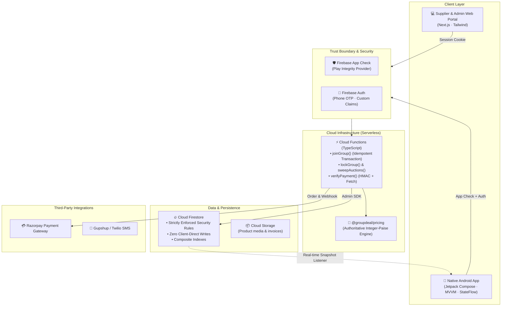

<div align="center">

# 🛒 GroupDeal
### Locality-Based Group Buying Commerce Platform with Dynamic Pricing & Reverse Supplier Bidding

[](./LICENSE)
[](./android)
[](./android)
[](./firestore)
[](./packages/pricing)
[](./packages/pricing)
[](./docs/SYSTEM_ARCHITECTURE.md)

<p align="center">
  <b>GroupDeal</b> bridges fragmented household demand and wholesale supplier pricing through hyperlocal group coordination, algorithmic tier-based price discovery, and sealed reverse supplier auctions.
</p>

</div>

---

## 📌 Executive Summary

Modern retail commerce leaves individual consumers paying steep retail markups for essential goods while local suppliers struggle with customer acquisition costs and uncertain demand volumes. **GroupDeal** solves this by:

1. **Aggregating Neighborhood Demand:** Consumers living in the same locality (geohash / PIN code) pool their orders for high-frequency commodities (e.g., farm-fresh produce, cold-pressed oils, staples).
2. **Dynamic Tier-Based Price Discovery:** As more consumers join an active pool, the unit price automatically unlocks cheaper pre-negotiated wholesale tiers in real-time.
3. **Reverse Supplier Auctions:** Once a group locks, verified regional suppliers bid downwards in a sealed auction to fulfill the batch. The winning bid drops the price even further, never exceeding the locked ceiling.
4. **Escrow Protection:** Consumers pay the finalized dynamic price through Razorpay with server-side HMAC validation and automatic payment capture verification.

---

## 🏗️ System Architecture



---

## 🚀 Key Innovations

### 1. Monotonic Integer-Paise Pricing Engine
- **Financial Invariant:** Zero floating-point arithmetic. All monetary values are represented as strict integer paise (`₹1 = 100 paise`), eliminating rounding vulnerabilities and decimal creep.
- **Shared Golden Vectors:** Validated across TypeScript and Kotlin implementations using identical golden-vector test matrices ([`packages/pricing/test/golden-vectors.json`](./packages/pricing/test/golden-vectors.json)).
- **Guaranteed Monotonicity:** Price strictly decreases with increasing volume; joining a group can never increase the unit price.

### 2. Zero-Trust Client Architecture
- Clients **never** write business data directly (groups, member counts, tiers, orders, payment status, auction bids).
- Every state mutation executes inside an atomic Cloud Functions Firestore transaction that re-reads server-side state, validates deadlines and capacities, and asserts strict finite state transitions.
- Client mutations require a unique UUIDv4 `requestId` recorded in an `idempotencyKeys` collection to ensure safe network retries.

### 3. Sealed Reverse Supplier Auctions
- Upon group lock, certified local suppliers participate in a sealed reverse auction.
- Winning bids are calculated deterministically: lowest unit price wins; ties break by supplier delivery rating and timestamp.
- If no supplier bids beat the locked price, the system automatically falls back to the pre-contracted anchor supplier.

---

## 📂 Repository Layout

```
.
├── .github/
│   └── workflows/
│       ├── android-ci.yml           # Automated Android unit tests on CI
│       └── pricing-tests.yml        # Node.js pricing engine golden vector CI
├── android/                         # Complete Jetpack Compose native Android application
│   ├── app/
│   │   ├── src/
│   │   │   ├── main/java/com/example/
│   │   │   │   ├── core/            # Models, repositories, locality & pricing engine
│   │   │   │   ├── ui/              # Screens (Discover, Detail, Orders, MyGroups, Auth)
│   │   │   │   └── MainActivity.kt
│   │   │   └── res/                 # UI assets, themes, layouts, strings
│   │   └── build.gradle.kts
│   ├── build.gradle.kts
│   ├── settings.gradle.kts
│   └── README.md
├── docs/                            # 24 authoritative architectural specifications
│   ├── GROUPDEAL_PRODUCTION_BLUEPRINT.md # Master production blueprint (145 KB)
│   ├── SYSTEM_ARCHITECTURE.md       # High-level architecture & trust boundaries
│   ├── DATABASE_SCHEMA.md           # Firestore schemas, types & indexing rules
│   ├── PRICING_ENGINE.md            # Pricing formulas, quotes & tier mechanics
│   ├── STATE_MACHINES.md            # Formal FSMs for groups, orders & auctions
│   ├── SUPPLIER_AUCTION.md          # Reverse auction rules & winner determination
│   ├── PAYMENTS.md                  # Escrow payment verification & webhook handling
│   ├── SECURITY.md                  # App Check, secret management & audit logs
│   ├── DECISIONS.md                 # Architectural Decision Records (ADRs D-01..D-20)
│   └── README.md                    # Complete documentation index
├── firestore/
│   ├── firestore.rules              # Production Firestore security rules
│   └── firestore.indexes.json       # Composite query index definitions
├── packages/
│   └── pricing/                     # Canonical TypeScript pricing engine
│       ├── src/engine.ts            # Pure quote & validation logic
│       ├── test/engine.test.ts      # Unit tests & golden vector assertions
│       ├── test/golden-vectors.json # Cross-platform test truth
│       └── package.json
├── reports/                         # Academic PBL and MAD deliverables
│   ├── GroupDeal_PBL_Report.pdf     # 102-page comprehensive academic report
│   ├── GroupDeal_PBL_Report_Final_Xerox.pdf # Final camera-ready report
│   ├── GroupDeal_PBL_Poster_A3 FINAL.pdf   # Exhibition A3 infographic poster
│   ├── GroupDeal_MAD_Review_Presentation.pptx # Project review presentation slides
│   ├── GroupDeal_Poster_Link.png    # Poster overview image
│   ├── GroupDeal_Project_Video.mp4  # HD video demo (preserved locally)
│   └── README.md
├── .gitignore                       # Multi-platform production gitignore
├── CLAUDE.md                        # Non-negotiable engineering rules & standards
├── CONTRIBUTING.md                  # Contribution guidelines & commit conventions
├── firebase.json                    # Firebase rules & emulator ports configuration
├── LICENSE                          # MIT License
└── README.md                        # Master repository documentation
```

---

## 🛠️ Technology Stack

| Domain | Technologies |
|---|---|
| **Mobile Application** | Kotlin 2.2, Jetpack Compose, Material 3, Navigation Compose, Kotlin Coroutines, StateFlow, Hilt, Room, Coil 3, Robolectric |
| **Backend & Cloud** | Firebase Cloud Functions (Node.js/TypeScript), Firebase Admin SDK, Secret Manager |
| **Database & Cache** | Cloud Firestore (with fine-grained security rules & composite indexes), Cloud Storage |
| **Security & Integrity** | Firebase App Check (Play Integrity Provider), Phone Auth, Role-Based Access Control (RBAC) |
| **Payments** | Razorpay Payment Gateway, Server-Side HMAC SHA-256 Signature Verification |
| **Pricing Engine** | Strict TypeScript (ES2022), Golden-Vector Parity Tested, Pure Math (Integer Paise) |

---

## ⚡ Quickstart & Local Setup

### 1. Pricing Engine Testing (Node.js)
```bash
# Navigate to the pricing package
cd packages/pricing

# Run the golden-vector test suite (Node 20+ or 22+)
npm test
```

### 2. Android Studio Setup
1. Launch **Android Studio Ladybug (2024.2.1+)**.
2. Select **Open** and navigate to the `android/` directory.
3. Allow Gradle to synchronize dependencies.
4. Copy the environment template:
   ```bash
   cp android/.env.example android/.env
   ```
5. Run the application on an emulator or connected device (API 24+).
6. To execute unit tests via Gradle:
   ```bash
   cd android
   ./gradlew test
   ```

### 3. Firebase Local Emulators
```bash
# Install Firebase CLI if not already installed
npm install -g firebase-tools

# Start Auth, Firestore, and Functions emulators
firebase emulators:start
```
The emulator UI will be available at `http://localhost:4000`.

---

## 🧪 Testing & Quality Invariants

| Category | Tooling / Harness | Criteria |
|---|---|---|
| **Pricing Parity** | Golden Vectors (`golden-vectors.json`) | 100% agreement across TypeScript and Kotlin ports. |
| **Security Invariants** | Firestore Unit Testing SDK | Deny all unauthorized client writes to groups, members, orders. |
| **Concurrency** | Parallel Burst Harness | No lost updates or race conditions when multiple users join concurrently. |
| **Financial Integrity** | Payment Verification Suite | Reject forged signatures, duplicate webhooks, and amount mismatches. |

---

## 👤 Author

Developed and maintained by **Arul Murugan M**.

---

## 📄 License & Proprietary Notice

Copyright © 2026 **Arul Murugan M**. All Rights Reserved.

This repository and its entire source codebase, architecture, and documentation are strictly **proprietary and confidential**. Viewing and review are permitted solely for recruitment, employment evaluation, and architectural audit purposes. 

**No individual or organization is permitted to copy, reproduce, mirror, fork, redistribute, or use this code (or derivatives thereof) for commercial or non-commercial purposes without the express, prior written authorization of Arul Murugan M.** See the [LICENSE](./LICENSE) file for complete legal terms.

