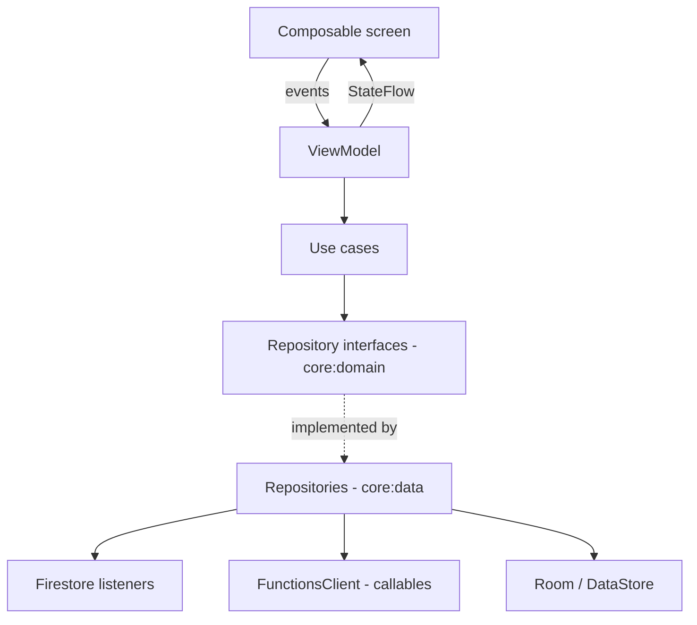

# Android Architecture (Customer App)

## 1. Stack
Kotlin 2.2.x · Jetpack Compose (latest stable BOM at Stage 0) · Material 3 · Navigation Compose (type-safe routes) · Hilt · Coroutines/Flow/StateFlow · Firebase BoM (Auth, Firestore, Functions, Messaging, App Check Play Integrity, Crashlytics, Analytics, Performance) · Razorpay Checkout SDK · Places SDK · Coil 3 · Room · DataStore (preferences) · JUnit 5/JUnit 4, MockK, Turbine, Compose UI test, Robolectric. Retrofit is **not** used in MVP (D-12). Versions are pinned in `gradle/libs.versions.toml` at Stage 0 (exact versions NOT VERIFIED here).

## 2. Modules
```
:app                       – Application, MainActivity, NavHost, Hilt entry, flavors dev/staging/prod
:core:model                – pure Kotlin domain models (Group, Tier, Order, Money(paise)…)
:core:domain               – use cases + PricingEngine port (pure Kotlin, golden-vector tested)
:core:data                 – repository implementations (Firestore, Functions, Room, DataStore), DTO mappers
:core:database             – Room DB, DAOs, entities (local-only data, D-13)
:core:network              – FunctionsClient wrapper (requestId, retry policy, error mapping), App Check setup
:core:designsystem         – theme (emerald), typography, components (PriceTag, TierRoadmap, ProgressMeter…)
:core:ui                   – shared composables (ErrorState, EmptyState, OfflineBanner), UiState helpers
:core:testing              – fakes, test dispatchers, golden vectors resource
:feature:auth              – phone OTP, Google, profile setup
:feature:locality          – permission rationale, resolve, picker
:feature:home              – rails, demand banner
:feature:discover          – feed, search, filters
:feature:group             – deal detail, join sheet, progress, leave
:feature:requests          – list, create, vote
:feature:orders            – list, detail, payment, tracking, rating, dispute
:feature:notifications     – inbox
:feature:profile           – profile, savings, settings, watchlist
```
Dependency rule: `feature → core:domain, core:ui, core:designsystem`; only `core:data` touches Firebase; `core:domain` has no Android dependencies.

## 3. Layering

Example: `JoinGroupUseCase(groupId, qty)` → `GroupRepository.join()` → `FunctionsClient.call("joinGroup", payload + requestId)` → maps `HttpsError` to `JoinError` sealed class.

## 4. State model
Each screen: `sealed interface XUiState { Loading; Content(...); Error(message, retry) ; Offline(cached?) }`. ViewModels expose `StateFlow` via `stateIn(viewModelScope, WhileSubscribed(5_000), Loading)`. One-off effects (navigation, snackbars) through `Channel`/`SharedFlow`. Firestore snapshot flows use `callbackFlow` with `awaitClose`, and drop snapshots whose `version` is lower than the last rendered one.

## 5. Key implementations
- **FunctionsClient:** generates `requestId` per user action (stored in the ViewModel so a retry reuses it), retry policy from API_SPECIFICATION.md, timeout 15 s, maps errors.
- **Pricing preview:** `PricingEngine.quote()` (Kotlin port) for "if you join, price becomes…" hints; always labelled as estimate; never sent to the server.
- **Payments:** `PaymentActivity` hosts Razorpay Checkout (`order_id`, key ID from server); on result, calls `verifyPayment` and then observes `orders/{id}` until PAID/failed.
- **Notifications:** `FirebaseMessagingService` stores token to `users/{uid}/devices/{installationId}`; subscribes to `group_<gid>` topics on join if the user enabled tier alerts; deep links `groupdeal://group/{gid}`, `groupdeal://order/{oid}`.
- **Location:** coarse location only (`ACCESS_COARSE_LOCATION`); lat/lng sent once to `resolveLocality`, never persisted.
- **App Check:** Play Integrity provider in staging/prod; debug provider in dev flavor.
- **Offline:** Firestore persistence on; `OfflineBanner` driven by `ConnectivityManager`; mutation buttons disabled offline.

## 6. Build variants
Flavors `dev` (emulators, debug App Check), `staging` (staging project, Razorpay test), `prod`. Separate `applicationIdSuffix` for dev/staging so all can be installed together. R8 full mode + resource shrinking in release; Crashlytics mapping upload in CI.

## 7. Quality gates
ktlint/detekt, Android Lint (warnings as errors for security checks), unit tests (domain + ViewModels with MockK/Turbine), Compose UI tests for critical flows, golden-vector parity test, baseline profiles (V1).
