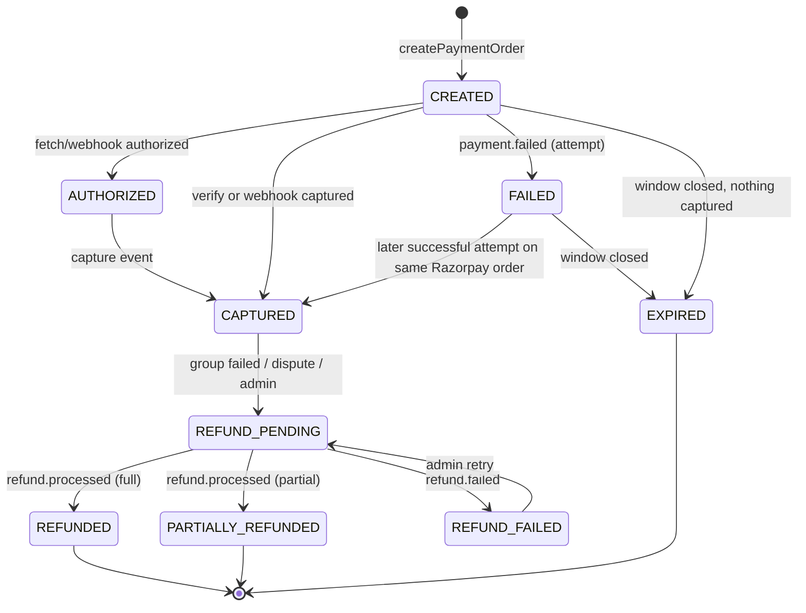

# Payments — Razorpay Integration

Principle: **a client success callback alone never marks an order paid** (ADR-11). Amounts always come from Firestore, never from the client.

## 1. Components
- Android: Razorpay Checkout SDK (Standard Checkout) with `order_id`.
- Functions: `createPaymentOrder`, `verifyPayment`, `razorpayWebhook`, `sweepPaymentWindows`, `reconcilePayments`, `adminRefundOrder`.
- Secrets (Secret Manager): `RAZORPAY_KEY_ID`, `RAZORPAY_KEY_SECRET`, `RAZORPAY_WEBHOOK_SECRET`.
- Collections: `orders`, `payments`, `paymentEvents`.

## 2. Flow
1. **createPaymentOrder(orderId, requestId)** — guard: owner, order AWAITING_PAYMENT, `now < paymentDueAt`, group PAYMENT_WINDOW. If an open `payments` doc with a Razorpay order exists, return it (re-use; Razorpay orders accept multiple attempts). Else call Razorpay `POST /v1/orders` with `amount = order.amountPaise`, `currency = INR`, `receipt = orderId`, `notes = {orderId, uid}`; save `payments/{pid}` CREATED. Return `{keyId, razorpayOrderId, amountPaise, prefill}`.
2. **Checkout** on device. User pays by UPI/card/netbanking.
3. **verifyPayment(orderId, razorpayOrderId, razorpayPaymentId, signature, requestId)** —
   a. HMAC-SHA256(`razorpayOrderId + "|" + razorpayPaymentId`, KEY_SECRET) must equal `signature` (constant-time compare).
   b. Fetch the payment from Razorpay (`GET /v1/payments/{id}`): `order_id` matches, `amount = order.amountPaise`, `currency = INR`, `status = captured` (auto-capture enabled in the dashboard).
   c. Transaction: if payment already CAPTURED → return success (idempotent); else payment CAPTURED (`verifiedBy: CLIENT_SIGNATURE+FETCH`), order PAID, member PAID, group `paidUnits += qty`, `paidMembers += 1`.
   d. If status is `authorized` (capture pending) → payment AUTHORIZED, client shows "confirming…" and listens to the order doc.
4. **Webhook** `POST /razorpayWebhook` — verify `X-Razorpay-Signature` = HMAC-SHA256(raw body, WEBHOOK_SECRET); dedupe on the event ID header in `paymentEvents/{eventId}`; handle `payment.captured`, `order.paid`, `payment.failed`, `refund.processed`, `refund.failed` by applying the same idempotent transitions. Respond 2xx only after a durable write; non-2xx makes Razorpay retry.
5. **Client UX:** after the SDK returns, the app shows a pending state and **listens to `orders/{id}`**; success is shown only when the server sets PAID.

## 3. Payment state machine

Invalid transitions (e.g. REFUNDED → CAPTURED, EXPIRED → CAPTURED without a captured event) are rejected by a transition table in code; a captured event arriving for an EXPIRED payment is treated as a **late payment**: payment CAPTURED then immediately REFUND_PENDING (auto refund), fraud signal not raised.

## 4. Idempotency and duplicates
| Duplicate | Protection |
|---|---|
| Double tap "Pay" | `createPaymentOrder` returns the existing open Razorpay order |
| Client verify + webhook both arrive | Both run the same transaction; second sees CAPTURED and no-ops |
| Webhook retried by Razorpay | `paymentEvents/{eventId}` existence check inside the transaction |
| verifyPayment retried by app | idempotency key + state check |
| Captured twice for same order (two attempts both succeed) | Second capture → auto refund + AMOUNT/DUPLICATE fraud signal for review |

## 5. Failures, cancellation, refunds
- **Failed attempt:** payment FAILED; order stays AWAITING_PAYMENT until `paymentDueAt`; user can retry.
- **Window ends unpaid:** order EXPIRED_UNPAID, member DEFAULTED, trust penalty (−40, configurable), payment EXPIRED.
- **User cancels before paying:** `cancelOrder` → CANCELLED, member DEFAULTED with smaller penalty (−15).
- **Group fails after some payments** (INSUFFICIENT_PAYMENT, NO_SUPPLIER after award, ADMIN_CANCELLED): every CAPTURED payment → REFUND_PENDING → Razorpay `POST /v1/payments/{id}/refund` (full amount, `notes.reason`) → REFUNDED on `refund.processed`.
- **Dispute resolution:** full or partial refund by admin with reason (audited).

## 6. Reconciliation (`reconcilePayments`, daily)
1. Payments CREATED/AUTHORIZED older than 1 h → fetch from Razorpay → apply missing transitions.
2. Orders PAID without a CAPTURED payment (should be impossible) → alert.
3. Razorpay captured payments of the last 48 h (list API by time range) not matched to a Firestore payment → alert + auto-refund after manual confirmation.
4. REFUND_PENDING older than 24 h → alert.
Output: summary doc in `adminActions` (system) and Cloud Logging metric; alert on any exception count > 0.

## 7. Settlement
MVP: platform account receives payments; admin records supplier settlement batches manually after delivery (`orders.settled`, `adminActions`). V1: Razorpay Route transfers on DELIVERED minus `platformFeeBps` (eligibility NOT VERIFIED, D-22).

## 8. Compliance notes
No card data touches GroupDeal servers (Razorpay-hosted checkout). Store only Razorpay IDs, method type and status. Webhook endpoint served over HTTPS by Cloud Functions. Tax invoices and GST treatment require accounting review (NOT VERIFIED).
