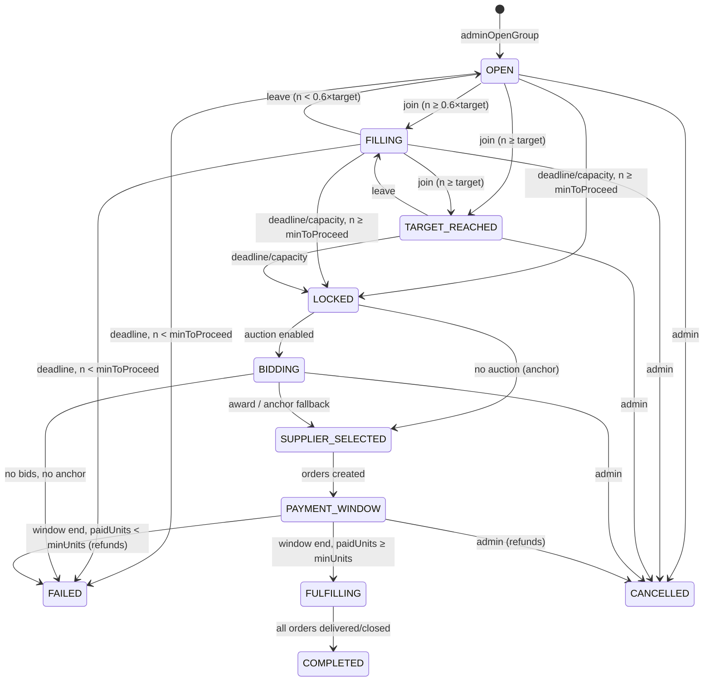
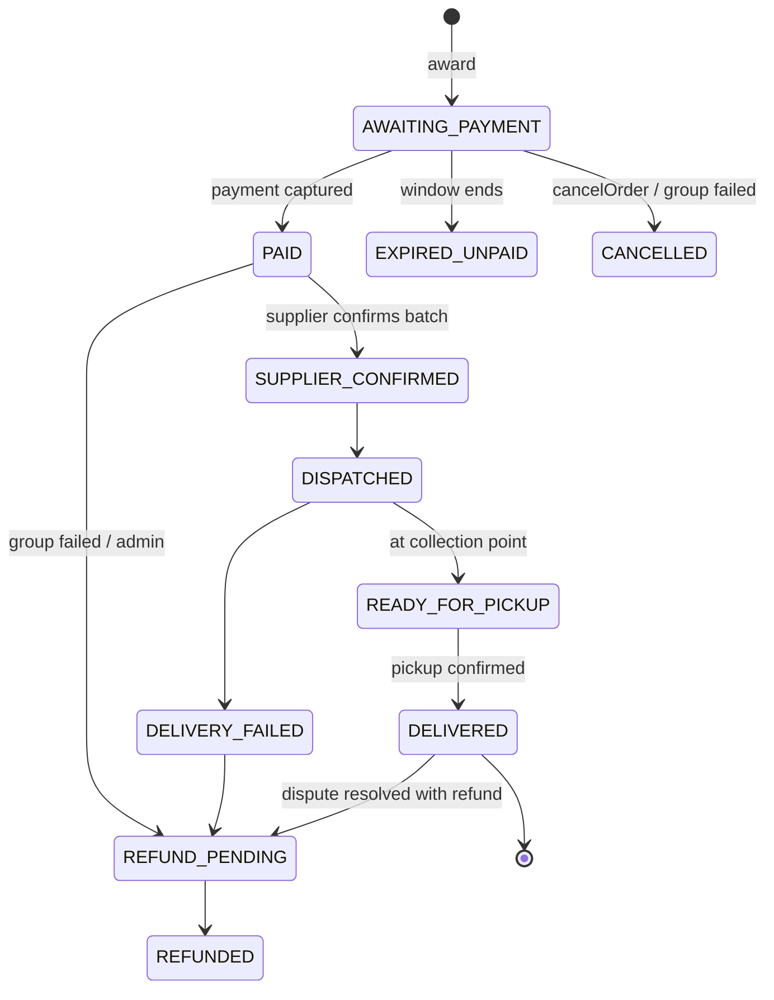

# State Machines

Each machine is implemented as a transition table in `functions/src/domain/states.ts` (`assertTransition(machine, from, to)`); any transition not listed throws `failed-precondition` and is logged. Clients never set states.

## 1. Deal
| From | To | Trigger |
|---|---|---|
| DRAFT | PENDING_REVIEW | supplier submits |
| PENDING_REVIEW | ACTIVE / REJECTED | admin decision |
| ACTIVE | PAUSED / ARCHIVED | admin |
| PAUSED | ACTIVE / ARCHIVED | admin |
Open groups are unaffected by PAUSED/ARCHIVED (snapshot); no new groups open.

## 2. Group

**Prototype mapping (D-24):** OPEN, FILLING, TARGET_REACHED, BIDDING, SUPPLIER_SELECTED unchanged; PAYMENT_PENDING → PAYMENT_WINDOW; PROCESSING → FULFILLING; DELIVERED → COMPLETED; EXPIRED → FAILED(MIN_NOT_REACHED); CANCELLED unchanged; new: LOCKED (transient), FAILED.

## 3. Membership (`groups/{gid}/members/{uid}`)
ACTIVE → LEFT (leave, pre-lock) · LEFT → ACTIVE (rejoin, joinCycles < 3) · ACTIVE → COMMITTED (lock) · ACTIVE → RELEASED (group FAILED before award) · COMMITTED → PAID (payment captured) · COMMITTED → DEFAULTED (window ends / order cancelled) · COMMITTED → RELEASED (group FAILED) · PAID → REFUNDED (group failed / dispute full refund).

## 4. Auction
OPEN → CLOSING (sweeper) → AWARDED | NO_VALID_BIDS · OPEN → CANCELLED (group cancelled). CLOSING exists only inside the award transaction.

## 5. Bid
ACTIVE (submit/revise; revise keeps ACTIVE, increments revision) → WITHDRAWN (before cut-off) → ACTIVE (re-bid) · ACTIVE → INVALIDATED (admin / supplier suspended) · ACTIVE → WON | LOST (award).

## 6. Request
OPEN → THRESHOLD_REACHED (votes ≥ threshold) → UNDER_REVIEW (admin opens) → CONVERTED (deal created) | REJECTED · OPEN → EXPIRED (expiresAt) · OPEN/THRESHOLD_REACHED → REJECTED (moderation). Votes allowed only in OPEN.

## 7. Order

`rated` is a flag, not a state. Disputes do not change order state until resolved.

## 8. Payment
See PAYMENTS.md §3: CREATED, AUTHORIZED, CAPTURED, FAILED, EXPIRED, REFUND_PENDING, REFUNDED, PARTIALLY_REFUNDED, REFUND_FAILED.

## 9. Delivery (group-level batch, `groups/{gid}.delivery.status`)
PENDING → PACKED → DISPATCHED → AT_COLLECTION_POINT → COMPLETED · DISPATCHED → FAILED_ATTEMPT → DISPATCHED (retry once) | RETURNED. Order states are updated from the batch, except DELIVERED which is per order (pickup).

## 10. Notification (inbox doc)
QUEUED → SENT (FCM accepted) → READ (user sets `readAt`) · QUEUED → FAILED (all tokens invalid) → (no retry for broadcast; one retry after 5 min for transactional) · Inbox doc exists regardless of push outcome, so the user can always see it in-app.
