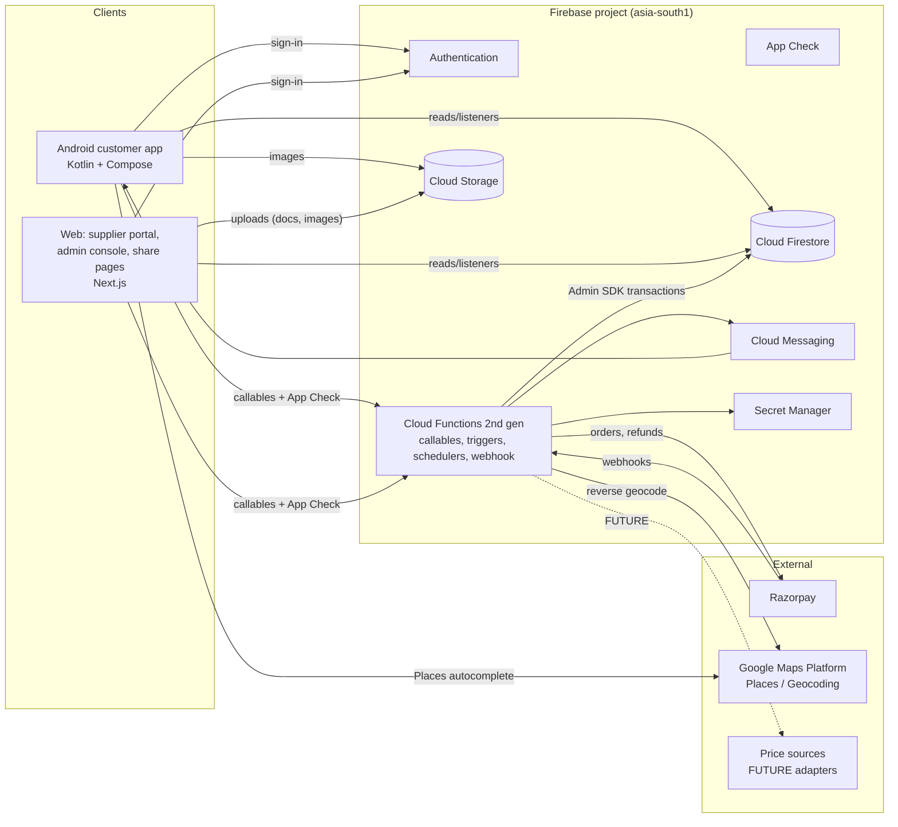
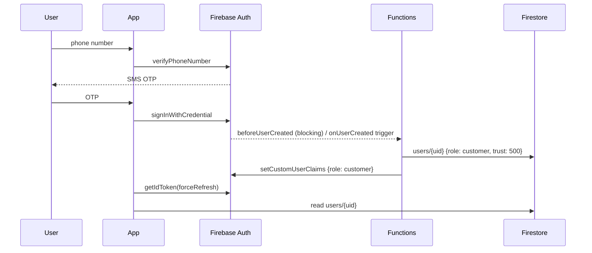
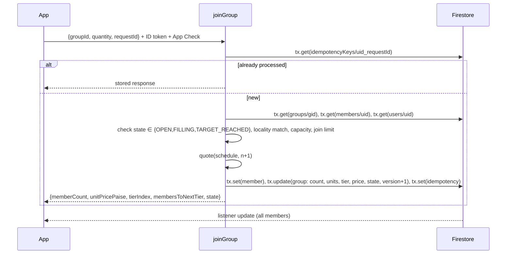
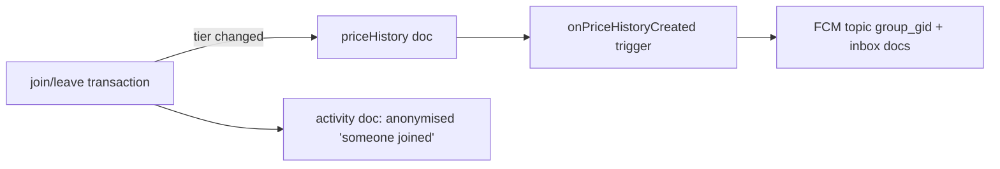
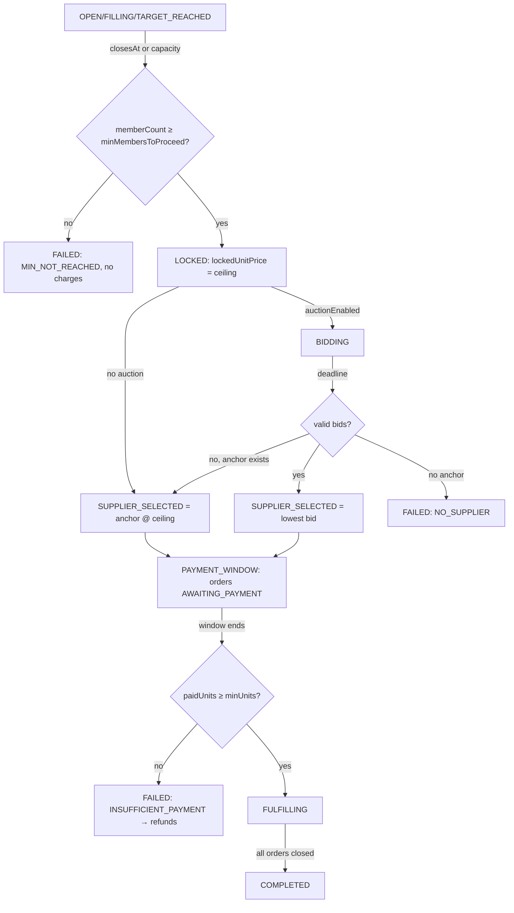
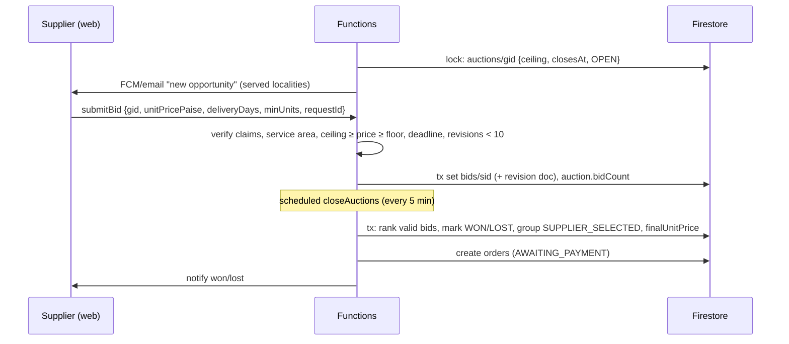
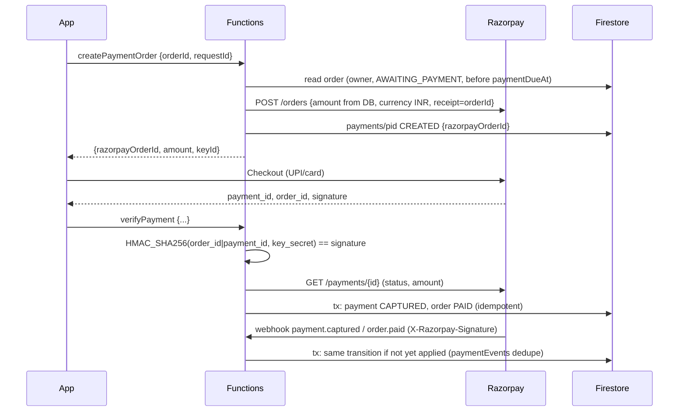
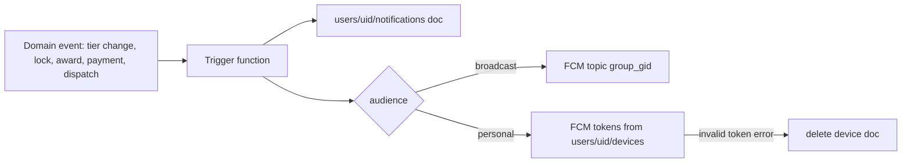

# System Architecture

## 1. High-level architecture

## 2. Logical architecture (bounded contexts)

| Context | Owns (collections) | Key operations |
|---|---|---|
| Identity | `users`, claims, `suppliers` | sign-in hooks, roles, supplier verification |
| Locality | `localities` | resolve, search, set user locality |
| Catalogue | `deals` | propose, approve, schedule groups |
| Group buying | `groups`, `groups/*/members`, `priceHistory`, `activity` | join, leave, lock, state |
| Pricing | `@groupdeal/pricing` (pure) | quote, validate, final price |
| Auction | `auctions`, `bids`, `revisions` | open, bid, close, award |
| Orders | `orders` | create at award, track, cancel |
| Payments | `payments`, `paymentEvents` | create order, verify, webhook, refund, reconcile |
| Engagement | `requests`, `votes`, `users/*/watchlist`, `users/*/notifications` | request, vote, notify |
| Trust & safety | `ratings`, `disputes`, `fraudSignals`, `adminActions` | rate, dispute, signal, audit |

## 3. Trust boundaries

| Value / operation | Trusted source | Never accepted from a client |
|---|---|---|
| Member count, units committed | Firestore transaction in `joinGroup`/`leaveGroup` | Any count, tier or price |
| Unit price, tier, savings | `@groupdeal/pricing` inside the function | Client-computed price |
| Locked/final price, order amount | Lock and award functions | Amount in `createPaymentOrder` |
| Payment success | Server signature check + Razorpay fetch, or verified webhook | SDK success callback alone |
| Auction winner | `closeAuctions` scheduled function | Supplier-declared result |
| Role, supplier status | Custom claims set by admin functions | Role field in profile |
| Trust score | Server recompute | Any client value |
| Locality of a user | Server-set `localityId` | Arbitrary locality in join requests (server reads profile) |
| Timestamps | `FieldValue.serverTimestamp()` | Client clocks |

**Authorisation happens in two places:** Firestore rules (reads, self-owned writes) and function guards (`requireAuth`, `requireRole`, `requireVerifiedSupplier`, ownership checks). App Check is enforced on both.

## 4. Responsibilities

**Android client:** render state, collect input, call functions with `requestId`, show estimates labelled as such, cache, handle Razorpay checkout UI, register FCM token.
**Web client:** supplier/admin UIs, SSR public share pages (read-only Admin SDK), same callables.
**Functions:** all invariants, money, deadlines, notifications, external APIs, audit, idempotency.

## 5. Core flows

### 5.1 Authentication

### 5.2 Join group (authoritative)

### 5.3 Pricing / tier change side effects

### 5.4 Purchase lifecycle

### 5.5 Supplier auction

### 5.6 Payment

### 5.7 Notifications

## 6. Component map (deployable units)

| Unit | Tech | Deploy |
|---|---|---|
| `android` | Kotlin, Compose, Hilt, Firebase SDKs, Razorpay SDK, Places SDK | Play Console (internal → closed → production) |
| `web` | Next.js (App Router), TypeScript, Tailwind, Firebase JS SDK, Admin SDK (server) | Firebase App Hosting |
| `functions` | TypeScript, Node 20, firebase-functions v2, firebase-admin, razorpay | `firebase deploy --only functions` |
| `packages/pricing` | TypeScript, zero dependencies | Built into functions and web |
| `firestore` | rules, indexes, rules tests | `firebase deploy --only firestore` |
