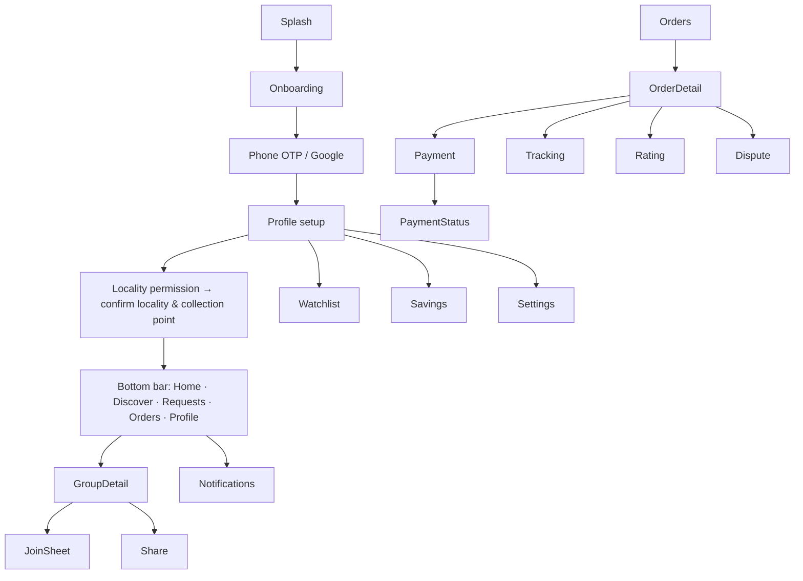

# UI / UX Specification

Design language carried over from the prototype: emerald primary (#0F9D58), dark-emerald secondary, orange accent for deal urgency; Material 3 components; rupee prices in large numerals; tier roadmap as the signature component.

## 1. Android navigation

Deep links open GroupDetail/OrderDetail directly (auth gate first).

## 2. Customer screens
| Screen | Key content | States |
|---|---|---|
| Splash | logo, session check | — |
| Onboarding (3 cards) | how tiers work; pay after lock; collection-point delivery | skip |
| Login | phone input (+91), OTP (6 boxes, auto-read SMS where available), Google button | sending, invalid OTP, rate-limited |
| Locality permission | rationale ("we use approximate location only to find your locality"), Allow / Enter pincode | denied → manual |
| Home | locality chip, rails: Closing soon, Almost next tier, New; demand banner | skeleton, empty locality ("No groups yet — request one") |
| Discover | search bar, category chips, sort, GroupCard list | loading, empty search, offline cached |
| Group detail | gallery, PriceTag (current, MRP, savings %), **TierRoadmap**, ProgressMeter (n/target), "12 more for ₹799", countdown, supplier card, delivery terms, quantity, Join / Leave | pre-lock, LOCKED ("price can only go down"), BIDDING, closed, FAILED reason |
| Join sheet | quantity stepper, estimated price, rules checkbox ("I'll pay within 24 h after supplier selection") | submitting, error (CLOSED/CAPACITY/LOCALITY) |
| Requests | locality requests with VoteBar (17/20), create FAB, my requests | vote pending, already voted |
| Orders | list grouped by status; pay-now CTA with deadline | empty |
| Order detail | product snapshot, amount, saved, timeline, actions (Pay, Cancel, Rate, Dispute) | |
| Payment status | "Confirming payment…" listening to server | success, failed (retry), pending > 2 min (contact support) |
| Tracking | vertical timeline, collection point + hours, pickup code | |
| Notifications | inbox list, unread dots | empty |
| Watchlist (V1) | saved groups with countdown | |
| Profile | name, locality, trust badge (tier + score), savings summary, settings, sign out | |
| Rating | stars + text | submitted |

## 3. Supplier (web)
Onboarding wizard (business → documents → service areas) · Verification status page · Dashboard (open opportunities, active bids, orders to fulfil) · Opportunities list (locality, units, ceiling, deadline countdown) · Auction page (deal snapshot, ceiling/floor, BidForm, my revisions) · Bid history · Won auctions · Fulfilment (batch actions: confirm, dispatched, at collection point; per-order delivered) · Analytics (V1) · Profile.

## 4. Admin (web)
Dashboard (today: groups locking, auctions closing, payments pending, open disputes, reconciliation exceptions) · Users · Suppliers (verification queue with document viewer) · Localities · Deals (approval queue with schedule validator output) · Groups (state filter, extend/cancel) · Requests (threshold queue, convert wizard) · Auctions (bids table, invalidate) · Orders · Payments (reconciliation exceptions) · Disputes · Moderation · Fraud signals (V1) · Analytics · Settings (`config/app` editor with diff preview).

## 5. Reusable components
`PriceTag(unitPaise, mrpPaise, estimate: Boolean)` · `TierRoadmap(tiers, activeIndex, lockedIndex?)` · `ProgressMeter(n, target, nextThreshold)` · `CountdownChip(closesAt)` · `GroupCard` · `SupplierCard` · `VoteBar` · `StatusTimeline` · `TrustBadge` · `OfflineBanner` · `EmptyState(icon, title, action)` · `ErrorState(message, retry)` · `SkeletonCard` · `ConfirmSheet`.

## 6. Cross-cutting rules
- **Loading:** skeletons for lists; button-level spinners for actions; never block the whole screen for a mutation.
- **Empty:** explain why and offer the next action (request a product, change locality).
- **Errors:** map server reason codes to plain language (e.g. CAPACITY → "This group is full. Watch for the next round.").
- **Offline:** cached content with banner; actions disabled with tooltip.
- **Estimates vs facts:** anything not from the server is labelled "Estimated".
- **Accessibility:** content descriptions on icons, prices read as "rupees nine hundred forty-nine", 48 dp targets, contrast AA, supports font scale 200%.
- **Dark mode:** full dark scheme (prototype already defines one).
- **Localisation:** all strings in resources from day one (Tamil, Hindi in V1); numbers in Indian grouping (₹8,118).

## 7. Screenshot/diagram slots for the report
Insert device screenshots (from the production build) for: Login, Locality, Home, Discover, Group detail (pre-lock and locked), Join sheet, Requests, Payment status, Tracking, Supplier auction page, Admin approval queue.
